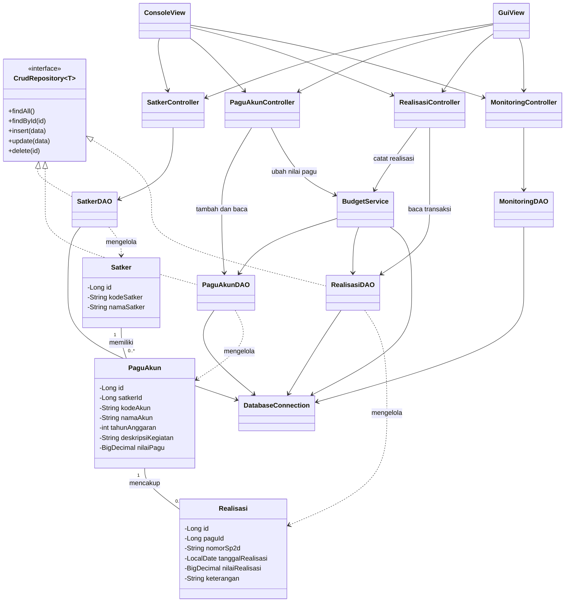
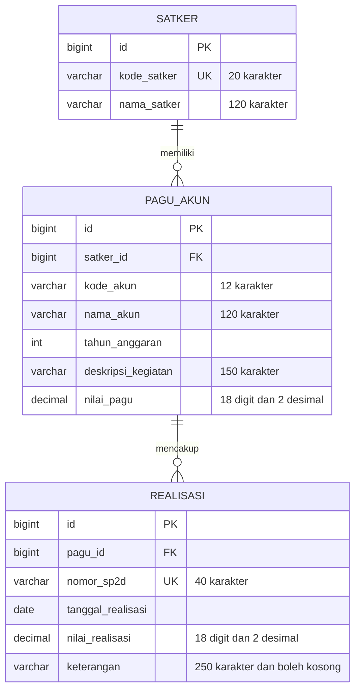
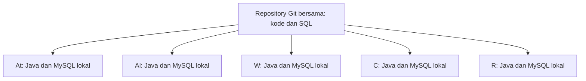

# SOFTWARE DESIGN DOCUMENT

## Aplikasi Monitoring Realisasi Anggaran Satker

**Topik:** B  
**Versi dokumen:** 1.4  
**Tim:** At, Al, W, C, R  
**Teknologi:** Java 25, Maven, JDBC, MySQL  
**Deadline yang telah disetujui:** **Jumat, 16 Oktober 2026 pukul 23.00 WIB**  
**Target kirim tim:** Jumat pukul 22.30 WIB  
**AI:** khusus R; aplikasi utama tetap berjalan tanpa AI.

## Daftar Isi

1. [Tujuan dan Ruang Lingkup](#1-tujuan-dan-ruang-lingkup)
2. [Arsitektur Aplikasi](#2-arsitektur-aplikasi)
3. [Struktur Direktori](#3-struktur-direktori)
4. [Desain Kelas](#4-desain-kelas)
5. [Hubungan Antarkelas](#5-hubungan-antarkelas)
6. [Desain Database](#6-desain-database)
7. [Menjalankan Aplikasi di Komputer Anggota](#7-menjalankan-aplikasi-di-komputer-anggota)
8. [Aturan Bisnis dan Proses](#8-aturan-bisnis-dan-proses)
9. [Impor CSV dan Penanganan Error](#9-impor-csv-dan-penanganan-error)
10. [AI Khusus R](#10-ai-khusus-r)
11. [Pembagian Tugas dan Rencana Kerja](#11-pembagian-tugas-dan-rencana-kerja)
12. [Pengujian dan Penyerahan](#12-pengujian-dan-penyerahan)

## 1. Tujuan dan Ruang Lingkup

Aplikasi membantu petugas Satker mencatat pagu dan realisasi anggaran, memeriksa sisa pagu, serta melihat persentase realisasi. **Core berarti aplikasi Java utama**, yang dijalankan di komputer setiap anggota dengan database MySQL masing-masing.

Fitur utama:

1. Pengelolaan Satker: tambah, lihat, ubah dan hapus.
2. Pengelolaan pagu per Satker, akun, tahun dan kegiatan.
3. Pencatatan dan penampilan realisasi dengan nomor SP2D.
4. Penolakan realisasi yang melebihi sisa pagu.
5. Monitoring total pagu, realisasi, sisa dan persen per Satker serta per akun.

Tambahan setelah fitur utama berjalan:

- Impor Satker dan pagu dari CSV.
- Dashboard progress bar dan peringkat Top 5 atau 10.
- Rekap bulanan dan tahunan berdasarkan tanggal transaksi.
- GUI Swing sebagai alternatif Console.
- Insight AI melalui plugin yang dikerjakan oleh R.

Semua data berupa **dummy**. Aplikasi tidak memakai autentikasi pengguna. Console menjadi antarmuka utama; jika Swing dibangun, keduanya memakai aturan bisnis yang sama.

## 2. Arsitektur Aplikasi

Aplikasi menggunakan **Model-View-Controller atau MVC**, dengan **Data Access Object atau DAO** untuk akses database. Nama kelas utama mengikuti v1.0. Satu `BudgetService` memusatkan pemeriksaan batas pagu dan transaksi uang.

| Bagian | Tanggung jawab |
| --- | --- |
| Model | Menyimpan representasi data Satker, pagu dan realisasi. |
| View | Menerima input dan menampilkan hasil melalui Console atau Swing. |
| Controller | Mengatur alur proses, memvalidasi input dan menerjemahkan error menjadi pesan pengguna. |
| DAO | Membaca atau menyimpan data melalui query JDBC. |
| BudgetService | Memeriksa sisa pagu dan menjalankan transaksi commit atau rollback. |
| Util | Membaca konfigurasi, menyediakan koneksi DB dan membantu impor CSV. |

Alur utama:

```text
View -> Controller -> DAO -> MySQL

Untuk pencatatan realisasi dan perubahan nilai pagu:
View -> Controller -> BudgetService -> DAO -> MySQL
```

Hasil dikembalikan melalui Controller untuk ditampilkan oleh View. DAO dalam satu transaksi memakai **koneksi yang sama** dari `BudgetService`; DAO tidak membuka koneksi baru atau commit sendiri.

**Alternatif desain:** seluruh kode dalam View lebih cepat ditulis, tetapi sulit diuji dan mudah menduplikasi aturan. MVC dengan DAO dipilih agar tugas setiap kelas jelas. Aturan transaksi uang dipusatkan pada `BudgetService`.

## 3. Struktur Direktori

Satu repository dipakai bersama. Folder `core-app` berisi aplikasi utama. File Java berada dalam package `id.capstone.anggaran` dan subpackage berikut.

```text
capstone-anggaran/
|-- core-app/
|   |-- pom.xml
|   `-- src/
|       |-- main/java/id/capstone/anggaran/
|       |   |-- model/
|       |   |   |-- Satker.java
|       |   |   |-- PaguAkun.java
|       |   |   |-- Realisasi.java
|       |   |   `-- MonitoringRow.java
|       |   |-- dao/
|       |   |   |-- CrudRepository.java
|       |   |   |-- SatkerDAO.java
|       |   |   |-- PaguAkunDAO.java
|       |   |   |-- RealisasiDAO.java
|       |   |   `-- MonitoringDAO.java
|       |   |-- controller/
|       |   |   |-- SatkerController.java
|       |   |   |-- PaguAkunController.java
|       |   |   |-- RealisasiController.java
|       |   |   `-- MonitoringController.java
|       |   |-- service/BudgetService.java
|       |   |-- view/console/ConsoleView.java
|       |   |-- view/gui/GuiView.java          [opsional]
|       |   |-- util/DatabaseConnection.java
|       |   |-- util/CsvImporter.java
|       |   |-- exception/PaguExceededException.java
|       |   |-- spi/AiInsightProvider.java
|       |   |-- spi/InsightRequest.java
|       |   |-- spi/InsightResponse.java
|       |   |-- MainConsole.java
|       |   `-- MainGui.java                  [opsional]
|       `-- test/java/id/capstone/anggaran/
|-- database/setup_demo.sql
|-- imports/import_satker.csv
|-- imports/import_pagu_akun.csv
|-- config/db.properties.example
|-- config/ai.properties.example             [opsional]
|-- ai-koboldcpp-plugin/                     [khusus R]
|-- docs/buglog.md
|-- laporan/
|-- README.md
`-- .gitignore
```

Setiap anggota membuat `config/db.properties` dari contoh. File tersebut, `config/ai.properties`, folder `target/` dan model `*.gguf` masuk `.gitignore`. Yang dibagikan melalui Git adalah kode, SQL dan konfigurasi contoh.

## 4. Desain Kelas

### 4.1 Kelas Model

Seluruh atribut domain bersifat `private`. Akses atribut dilakukan melalui getter dan setter yang sesuai.

| Kelas | Atribut utama | Tanggung jawab |
| --- | --- | --- |
| Satker | `id`, `kodeSatker`, `namaSatker` | Merepresentasikan data Satker. |
| PaguAkun | `id`, `satkerId`, `kodeAkun`, `namaAkun`, `tahunAnggaran`, `deskripsiKegiatan`, `nilaiPagu` | Merepresentasikan pagu untuk suatu akun dan kegiatan. |
| Realisasi | `id`, `paguId`, `nomorSp2d`, `tanggalRealisasi`, `nilaiRealisasi`, `keterangan` | Merepresentasikan transaksi realisasi. |

Nilai uang menggunakan `BigDecimal` untuk menjaga ketelitian perhitungan. Tanggal menggunakan `LocalDate`, sedangkan ID menggunakan `Long`.

Contoh deklarasi kelas mengikuti v1.0:

```java
public class Satker {
    private Long id;
    private String kodeSatker;
    private String namaSatker;

    public Long getId() {
        return id;
    }

    public String getKodeSatker() {
        return kodeSatker;
    }

    public void setKodeSatker(String kodeSatker) {
        this.kodeSatker = kodeSatker;
    }

    public String getNamaSatker() {
        return namaSatker;
    }

    public void setNamaSatker(String namaSatker) {
        this.namaSatker = namaSatker;
    }
}
```

Pola enkapsulasi yang sama diterapkan pada `PaguAkun` dan `Realisasi`. Setter hanya disediakan untuk atribut yang memang boleh diubah. Contoh di atas mempertahankan v1.0; implementasi lengkap juga memerlukan konstruktor untuk mengisi ID dari hasil query. `MonitoringRow` merupakan data hasil rekap, bukan tabel baru.

### 4.2 Interface dan Polimorfisme

Interface `CrudRepository<T>` menyediakan operasi akses data yang umum digunakan. Lima method mengikuti v1.0; `SQLException` dideklarasikan agar kegagalan JDBC dapat ditangani oleh pemanggil.

```java
import java.sql.SQLException;
import java.util.List;

public interface CrudRepository<T> {
    List<T> findAll() throws SQLException;
    T findById(long id) throws SQLException;
    void insert(T data) throws SQLException;
    void update(T data) throws SQLException;
    void delete(long id) throws SQLException;
}
```

Implementasi mengikuti pola v1.0:

```java
SatkerDAO implements CrudRepository<Satker>
PaguAkunDAO implements CrudRepository<PaguAkun>
RealisasiDAO implements CrudRepository<Realisasi>
```

**Pembatasan RealisasiDAO:** walaupun mengikuti interface CRUD seperti v1.0, `update()` dan `delete()` harus menolak operasi dengan `UnsupportedOperationException`. Controller realisasi hanya menyediakan pencatatan dan pembacaan transaksi.

Contoh penggunaan polimorfisme:

```java
CrudRepository<Satker> repository =
        new SatkerDAO(connection);

List<Satker> daftarSatker = repository.findAll();
```

Variabel `repository` menggunakan tipe interface, tetapi pemanggilan method dijalankan oleh implementasi `SatkerDAO`. Dengan demikian, interface digunakan dalam kode, bukan sekadar dideklarasikan.

### 4.3 Kelas DAO

| Kelas | Tanggung jawab |
| --- | --- |
| SatkerDAO | CRUD Satker melalui JDBC. |
| PaguAkunDAO | Menambah, melihat dan mengubah pagu; penghapusan mengikuti integritas referensial. |
| RealisasiDAO | Menambah dan melihat transaksi realisasi serta menghitung total realisasi; menolak update dan delete. |
| MonitoringDAO | Mengambil data monitoring dan rekap berdasarkan periode. |

Seluruh query dijalankan menggunakan `PreparedStatement`. Nilai input tidak boleh digabungkan langsung ke string SQL. Dalam transaksi anggaran, DAO memakai koneksi yang diberikan `BudgetService`.

### 4.4 Kelas Controller

| Kelas | Tanggung jawab |
| --- | --- |
| SatkerController | Memvalidasi dan mengatur CRUD Satker. |
| PaguAkunController | Memvalidasi dan mengatur pengelolaan pagu; memakai BudgetService untuk perubahan nilai pagu. |
| RealisasiController | Memvalidasi dan mencatat realisasi melalui BudgetService; menangani pelanggaran pagu. |
| MonitoringController | Mengambil data monitoring, menyiapkan rekap, dashboard, ranking dan insight AI opsional. |

Controller menangani input dari View dan mengembalikan hasil atau pesan kesalahan yang dapat dipahami pengguna.

### 4.5 Kelas Utilitas dan Exception

- **DatabaseConnection:** membaca konfigurasi dan menyediakan koneksi JDBC.
- **PaguExceededException:** exception khusus ketika pencatatan realisasi melampaui sisa pagu.
- **MainConsole:** menjalankan aplikasi Console.
- **MainGui:** menjalankan GUI Swing jika fitur ini dibangun.

Pendukung tambahan yang tetap dibatasi:

- **BudgetService:** mengunci pagu, memeriksa sisa dan menjalankan commit atau rollback.
- **CsvImporter:** memeriksa dan menyimpan data CSV melalui DAO.
- **MonitoringRow:** menampung kode Satker, pagu, realisasi, sisa dan persen hasil rekap.

Kontrak AI dijelaskan pada bagian 10 dan dikerjakan oleh R.

## 5. Hubungan Antarkelas

Diagram berikut mempertahankan kelas dan pola hubungan v1.0. `nomorSp2d` ditambahkan pada Realisasi; `BudgetService` menjadi satu penghubung tambahan untuk aturan transaksi uang.



**Hubungan domain:**

1. Satu Satker dapat memiliki banyak pagu akun.
2. Satu pagu akun dapat memiliki banyak transaksi realisasi.
3. Setiap pagu akun terhubung ke satu Satker.
4. Setiap transaksi realisasi terhubung ke satu pagu akun.

Angka `0..*` berarti nol atau banyak. Garis putus dengan segitiga berarti DAO menerapkan interface. `RealisasiDAO` tetap hanya mengizinkan tambah dan baca meskipun memakai interface CRUD.

## 6. Desain Database

Database menggunakan **MySQL InnoDB** dengan tiga tabel utama. Struktur tabel mengikuti v1.0 dan diselaraskan dengan `setup_demo.sql`.

### 6.1 Diagram Database



`PK` berarti primary key, `FK` foreign key dan `UK` unik. Seluruh ID dibuat otomatis melalui `AUTO_INCREMENT`.

### 6.2 Ketentuan Tabel

1. `kode_satker` harus unik.
2. Kombinasi `satker_id`, `kode_akun`, `tahun_anggaran` dan `deskripsi_kegiatan` pada pagu harus unik.
3. Semua kolom wajib diisi kecuali `keterangan`.
4. `nilai_pagu >= 0` dan `nilai_realisasi > 0`.
5. FK memakai `ON DELETE RESTRICT` dan `ON UPDATE RESTRICT`; induk yang masih digunakan tidak boleh dihapus.
6. Akun realisasi diperoleh melalui `pagu_id`, bukan disimpan ulang pada tabel realisasi.
7. Untuk demo, satu nomor SP2D unik global mewakili satu realisasi pada satu pagu. SP2D dengan beberapa akun memerlukan desain header dan detail pada pengembangan berikutnya.

### 6.3 Contoh Tabel Realisasi

```sql
CREATE TABLE realisasi (
    id BIGINT PRIMARY KEY AUTO_INCREMENT,
    pagu_id BIGINT NOT NULL,
    nomor_sp2d VARCHAR(40) NOT NULL UNIQUE,
    tanggal_realisasi DATE NOT NULL,
    nilai_realisasi DECIMAL(18,2) NOT NULL,
    keterangan VARCHAR(250),
    FOREIGN KEY (pagu_id) REFERENCES pagu_akun(id)
        ON DELETE RESTRICT ON UPDATE RESTRICT,
    CHECK (nilai_realisasi > 0)
) ENGINE=InnoDB;
```

Gunakan `setup_demo.sql` lengkap untuk membuat ketiga tabel dan data awal. Batas total realisasi terhadap pagu diperiksa oleh `BudgetService`, bukan hanya oleh CHECK database.

## 7. Menjalankan Aplikasi di Komputer Anggota

**Ya, langkah ini dilakukan oleh kelima anggota pada komputer masing-masing.** Setiap anggota menjalankan aplikasi Java dan MySQL lokal. `localhost` menunjuk ke komputer anggota tersebut. Perubahan data pada komputer At tidak otomatis muncul pada komputer Al.



### 7.1 Langkah Setiap Anggota

1. **Pasang alat:** JDK 25 LTS Eclipse Temurin, NetBeans 31, Maven dan MySQL 8.4. Pastikan `java -version` dan `mvn -version` menggunakan JDK 25.
2. **Ambil kode:** clone repository tim, lalu buka `core-app` sebagai proyek Maven di NetBeans. Ambil perubahan terbaru sebelum integrasi.
3. **Siapkan DB lokal:** jalankan `database/setup_demo.sql` pada MySQL lokal. Hasil awal adalah **12 Satker, 26 pagu dan 52 realisasi**. Skrip ini menghapus dan membuat ulang tiga tabel; jalankan hanya pada database dummy.
4. **Isi konfigurasi:** salin `config/db.properties.example` menjadi `config/db.properties`, lalu isi kredensial MySQL milik anggota tersebut.

```properties
db.url=jdbc:mysql://localhost:3306/monitoring_satker_demo
db.user=USER_MYSQL_LOKAL
db.password=PASSWORD_MYSQL_LOKAL
```

5. **Build dan jalankan:** setelah kode tim tersedia, buka PowerShell dari folder utama `capstone-anggaran`. Pengunduhan dependency pertama memerlukan jaringan.

```powershell
mvn -f core-app/pom.xml clean test package
mvn -f core-app/pom.xml dependency:copy-dependencies
$cp = "core-app/target/core-app-1.3.0.jar;core-app/target/dependency/*"
java "-Ddb.config=config/db.properties" -cp $cp `
  id.capstone.anggaran.MainConsole
```

6. **Coba alur utama:** lihat Satker, pilih pagu, catat realisasi dan buka monitoring. Tutup dan jalankan kembali aplikasi untuk memastikan data tetap tersimpan.

Kode, SQL dan konfigurasi contoh dibagikan melalui Git. Password, database lokal dan data latihan baru tidak disinkronkan. Untuk membandingkan hasil uji, setiap anggota mulai dari data dummy yang sama.

### 7.2 Pengaturan Maven oleh Al

Al menyiapkan satu `pom.xml` yang dipakai seluruh tim. Versi aplikasi tetap `1.3.0`; versi dokumen `1.4` tidak mengubah nama JAR aplikasi.

| Pengaturan | Nilai |
| --- | --- |
| Koordinat aplikasi | `id.capstone:core-app:1.3.0` |
| Java dan encoding | `maven.compiler.release=25`, `project.build.sourceEncoding=UTF-8` |
| Driver JDBC | `com.mysql:mysql-connector-j:9.7.0` |
| Pembaca CSV | `org.apache.commons:commons-csv:1.14.1` |
| JUnit, scope test | `org.junit.jupiter:junit-jupiter:5.13.4` |
| Maven Compiler Plugin | `3.16.0` |
| Maven Surefire Plugin | `3.6.0` |
| Maven Dependency Plugin | `3.11.0` |

`DatabaseConnection` membaca lokasi file dari system property `db.config`, dengan default `config/db.properties`. File dibaca menggunakan `java.util.Properties`. Bila file tidak ada atau koneksi gagal, tampilkan pesan yang jelas tanpa menampilkan password.

## 8. Aturan Bisnis dan Proses

### 8.1 Pengelolaan Satker

1. Pengguna mengisi kode dan nama Satker; keduanya wajib dan tidak boleh kosong.
2. Controller memeriksa input, lalu DAO menyimpan data dengan `PreparedStatement`.
3. Kode Satker harus unik.
4. Satker dapat ditambah, dilihat, diubah dan dihapus.
5. Penghapusan ditolak jika Satker masih memiliki pagu akun.

### 8.2 Pengelolaan Pagu

1. Pengguna memilih Satker dan mengisi akun, nama akun, tahun, kegiatan serta nilai pagu.
2. Nilai pagu tidak boleh negatif. Nominal memakai `BigDecimal`, maksimal dua angka desimal dan sesuai kapasitas `DECIMAL(18,2)`.
3. Kombinasi Satker, akun, tahun dan deskripsi kegiatan harus unik.
4. Pagu boleh diubah, tetapi nilai baru tidak boleh lebih kecil dari realisasi yang sudah tercatat.
5. Setelah ada realisasi, Satker, akun, tahun dan kegiatan pada pagu tidak boleh diubah.
6. Penghapusan pagu ditolak jika masih memiliki transaksi realisasi.

### 8.3 Pencatatan Realisasi

1. Pengguna memilih pagu akun dan mengisi nomor SP2D, tanggal, nilai serta keterangan.
2. Nomor SP2D wajib dan unik. Tanggal memakai format `yyyy-MM-dd` dan harus valid.
3. Nilai realisasi harus lebih dari nol, maksimal dua angka desimal dan sesuai kapasitas `DECIMAL(18,2)`.
4. `BudgetService` memeriksa total realisasi yang sudah tercatat.
5. Jika total baru melebihi pagu, proses dibatalkan, transaksi di-rollback dan `PaguExceededException` ditangani Controller.
6. Jika valid, realisasi disimpan dan transaksi di-commit.
7. Realisasi yang sudah tersimpan hanya dapat dilihat; tidak dapat diubah atau dihapus melalui aplikasi.

**Cara menjaga batas pagu saat dua transaksi bersamaan — Al dan W:**

1. Gunakan satu koneksi, isolation `READ_COMMITTED` dan `setAutoCommit(false)`.
2. Kunci baris pagu dengan `SELECT ... FROM pagu_akun WHERE id = ? FOR UPDATE`.
3. Sesudah kunci diperoleh, hitung ulang total realisasi dan sisa pagu pada koneksi yang sama.
4. Periksa nominal, simpan realisasi dan commit. Jika gagal, rollback.
5. Perubahan nilai pagu memakai kunci yang sama. DAO tidak membuat koneksi baru atau commit sendiri; pemilik transaksi menutup koneksi setelah selesai.

### 8.4 Monitoring dan Rekapitulasi

Untuk setiap pagu akun, aplikasi menampilkan:

1. Total realisasi.
2. Sisa anggaran = nilai pagu − total realisasi.
3. Persentase realisasi = total realisasi ÷ nilai pagu × 100%.
4. Jika pagu nol, persentase ditetapkan `0%`.

Rekap per Satker atau akun menjumlahkan pagu dan realisasi terlebih dahulu, lalu menghitung persentase dari kedua total. **Jangan merata-ratakan persentase setiap baris.** Hitung total realisasi per `pagu_id` sebelum menggabungkannya dengan pagu agar pagu tidak terhitung berulang karena banyak transaksi.

Perhitungan uang tetap memakai `BigDecimal`; pembulatan `HALF_UP` dua desimal dilakukan saat menampilkan persen. Data query ditampung dan diolah menggunakan `List` atau `Map`, misalnya:

```java
List<Realisasi> daftarRealisasi;
Map<Integer, BigDecimal> totalRealisasiPerBulan;
Map<Integer, BigDecimal> totalRealisasiPerTahun;
```

Rekap dapat difilter berdasarkan Satker, akun, kegiatan dan periode. Rekap bulanan memakai bulan dari tanggal realisasi; rekap tahunan memakai tahun dari tanggal realisasi. Filter **tahun anggaran** mengikuti data pagu.

**Dashboard tambahan:** tampilkan progress bar 20 karakter serta Top 5 atau 10 berdasarkan persen realisasi pada tahun yang dipilih. Urutan ASC atau DESC memakai nilai persen sebelum pembulatan; nilai seri diurutkan berdasarkan kode Satker ASC. Bila data kurang dari jumlah yang dipilih, tampilkan seluruh data yang tersedia. Persentase serapan tidak langsung menunjukkan kualitas kinerja.

### 8.5 Angka Pembanding dari Data Dummy

Angka berikut berlaku setelah menjalankan `setup_demo.sql`, sebelum impor atau transaksi uji baru. Semua nominal dalam rupiah.

| Filter | Pagu | Realisasi | Sisa | Persen |
| --- | ---: | ---: | ---: | ---: |
| Seluruh Satker, 2026 | 4.050.000.000 | 1.798.750.000 | 2.251.250.000 | 44,41% |
| DM-SK-001, 2026 | 200.000.000 | 188.000.000 | 12.000.000 | 94,00% |
| Akun 900101, 2026 | 2.430.000.000 | 1.079.250.000 | 1.350.750.000 | 44,41% |
| Akun 900102, 2026 | 1.620.000.000 | 719.500.000 | 900.500.000 | 44,41% |
| Seluruh Satker, 2025 | 140.000.000 | 92.800.000 | 47.200.000 | 66,29% |

Untuk `pagu_id = 1`, pagu awal Rp120.000.000 dan realisasi Rp112.800.000; sisa Rp7.200.000 menjadi dasar uji batas dan transaksi bersamaan.

## 9. Impor CSV dan Penanganan Error

### 9.1 Impor Data Tambahan

`CsvImporter` dipanggil dari menu Satker atau pagu. Fitur ini dikerjakan setelah input manual berjalan. **Impor Satker dahulu, kemudian pagu.**

Contoh isi `import_satker.csv`:

```csv
kode_satker,nama_satker
DM-SK-013,Satker Impor Contoh 13
```

Contoh isi `import_pagu_akun.csv`:

```csv
kode_satker,kode_akun,nama_akun,tahun_anggaran,deskripsi_kegiatan,nilai_pagu
DM-SK-013,900101,Operasional Simulasi,2026,Kegiatan Operasional Contoh,100000000.00
```

1. **Baca dan periksa:** UTF-8, boleh diawali BOM, pemisah koma dan header sesuai contoh. Nominal memakai titik desimal tanpa pemisah ribuan. Gunakan Apache Commons CSV agar teks berkutip dan berkoma terbaca benar; jangan memakai `split(",")`.
2. **Tampilkan hasil pemeriksaan:** tampilkan jumlah baris dan error beserta nomor baris. Jika ada error, jangan simpan. Jika valid, pengguna memilih Lanjut atau Batal. Untuk pagu, cari Satker melalui `kode_satker`, bukan ID dari CSV.
3. **Simpan satu file utuh:** semua baris satu file memakai satu koneksi dan satu transaksi. Bila satu penyimpanan gagal, rollback seluruh file. File Satker dan file pagu merupakan dua transaksi terpisah; kegagalan file pagu tidak membatalkan file Satker yang sudah berhasil.
4. **Tolak duplikat:** impor hanya menambah data. Duplikat dalam file atau database membuat file ditolak. Impor ulang tidak menambah baris. Tidak ada penimpaan atau pengabaian baris secara diam-diam.

| Tahap | Satker | Pagu | Realisasi |
| --- | ---: | ---: | ---: |
| Setelah setup | 12 | 26 | 52 |
| Setelah impor Satker | 17 | 26 | 52 |
| Setelah impor pagu | 17 | 36 | 52 |

Impor menambah pagu 2026 sebesar **Rp900.000.000**. Total pagu menjadi Rp4.950.000.000, realisasi tetap Rp1.798.750.000, sisa Rp3.151.250.000 dan serapan menjadi 36,34%.

### 9.2 Tiga Kelompok Error yang Penting

| Kondisi | Penanganan |
| --- | --- |
| Input atau file tidak valid | Tangani error format angka, tanggal, kolom wajib dan pembacaan file. Tampilkan field atau nomor baris, minta perbaikan dan kembali ke menu. |
| Realisasi melebihi pagu | Tangani `PaguExceededException`, rollback dan tampilkan sisa pagu yang tersedia. |
| Duplikat, FK atau kegagalan database | Tangani `SQLException`, rollback transaksi yang gagal, lalu tampilkan pesan sesuai masalah. Log detail teknis dan SQLState tanpa password. |

Satu custom exception cukup:

```java
public class PaguExceededException extends RuntimeException {
    public PaguExceededException(String pesan) {
        super(pesan);
    }
}
```

Controller menangkap error yang relevan; Console menampilkan pesan dan Swing memakai dialog. `UnsupportedOperationException` pada `RealisasiDAO` hanya menjadi pengaman internal untuk larangan update/delete; menu tidak menawarkan kedua operasi tersebut.

**Akses database:** semua query menggunakan `PreparedStatement`. Contoh pencarian:

```java
String sql = "SELECT * FROM satker WHERE kode_satker = ?";
try (PreparedStatement ps = connection.prepareStatement(sql)) {
    ps.setString(1, kodeSatker);
    try (ResultSet rs = ps.executeQuery()) {
        // Petakan hasil query menjadi objek Satker.
    }
}
```

Nama kolom dan arah pengurutan dipilih dari daftar yang ditentukan aplikasi. Tutup statement dan result set dengan `try-with-resources`; koneksi ditutup oleh pemilik transaksi, bukan DAO yang sedang memakai koneksi bersama.

## 10. AI Khusus R

**R mengerjakan AI setelah Core lolos pengujian.** Anggota lain menjalankan aplikasi tanpa model atau plugin AI. Angka rekap tetap dihitung oleh Java. AI hanya menambahkan narasi paling banyak tiga poin: Satker dengan serapan tertinggi, terendah dan pertanyaan tindak lanjut.

### 10.1 Langkah R

1. **Siapkan model lokal:** jalankan KoboldCpp, muat model GGUF yang sesuai perangkat dan uji endpoint `http://localhost:5001/v1/chat/completions`.
2. **Sepakati kontrak di Core:** `AiInsightProvider` adalah interface; `InsightRequest` membawa tahun dan `List<MonitoringRow>`; `InsightResponse` membawa status tersedia dan teks hasil. Snapshot berisi kode Satker, pagu, realisasi, sisa dan persen. Gunakan data rekap yang tidak dapat diubah serta `List.copyOf` untuk menyalin daftar.

```java
public interface AiInsightProvider {
    InsightResponse analyze(InsightRequest request);
}
```

3. **Buat plugin terpisah:** proyek `ai-koboldcpp-plugin` menggunakan Java 25. Dependency `id.capstone:core-app:1.3.0` memakai scope `provided`; `com.google.code.gson:gson:2.13.2` membaca JSON. Core tidak memiliki dependency ke plugin.

```text
ai-koboldcpp-plugin/
|-- pom.xml
`-- src/main/
    |-- java/id/capstone/anggaran/ai/
    |   `-- KoboldCppInsightProvider.java
    `-- resources/META-INF/services/
        `-- id.capstone.anggaran.spi.AiInsightProvider
```

4. **Daftarkan provider:** file pada `META-INF/services` di atas berisi satu baris berikut. Provider mempunyai konstruktor `public` tanpa argumen; koneksi ke model dilakukan saat analisis diminta.

```text
id.capstone.anggaran.ai.KoboldCppInsightProvider
```

5. **Pasang di komputer demo AI:** jalankan `mvn -f core-app/pom.xml clean install`, kemudian ulangi `dependency:copy-dependencies` untuk Core. Build plugin dan salin dependency plugin. Classpath harus berisi JAR Core, dependency Core, JAR plugin dan dependency plugin. Restart aplikasi; `MonitoringController` memuat provider melalui `ServiceLoader`.
6. **Isi konfigurasi:** simpan pengaturan berikut pada `config/ai.properties`. Bila file tidak ada, AI dinonaktifkan.

```properties
ai.enabled=true
ai.endpoint=http://localhost:5001/v1/chat/completions
ai.model=MODEL_YANG_DIMUAT
```

### 10.2 Batas dan Fallback

- Kirim hanya snapshot dummy. Plugin tidak menerima koneksi, DAO atau akses untuk mengubah database.
- Gunakan `HttpClient`: connect timeout 2 detik dan request timeout 10 detik. Baca teks dari `choices[0].message.content`.
- Tanpa JAR plugin, provider rusak, model mati, timeout, HTTP gagal atau JSON tidak valid: tampilkan **“AI tidak tersedia”** dan tetap tampilkan rekap.
- Tangani `ServiceConfigurationError` saat memuat provider. Jika menangani `InterruptedException`, pulihkan status interrupt thread.
- Prompt menggunakan hanya angka snapshot, tidak mengarang penyebab dan tidak menilai kinerja dari persentase serapan saja. Beri label **Insight AI** pada narasi tambahan.

R menguji kondisi tanpa plugin, model mati, provider rusak dan model aktif. Jika Core belum stabil pada Jumat pukul 08.00 WIB, R membantu pengujian Core terlebih dahulu. AI dilanjutkan setelah fitur utama stabil dan sebelum pembekuan fitur.

## 11. Pembagian Tugas dan Rencana Kerja

### 11.1 Peran Lima Anggota

| Anggota | Pekerjaan utama | Bukti selesai |
| --- | --- | --- |
| At | Tiga model, diagram kelas/DB, SQL dan data dummy. | Model sesuai desain, SQL dapat dijalankan dan angka dummy terverifikasi. |
| Al | Konfigurasi MySQL, repository, empat DAO, query dan penguncian transaksi. | CRUD, FK, query berparameter dan koneksi bersama berjalan. |
| W | Controller, BudgetService, aturan bisnis dan impor CSV. | Batas pagu, rollback dan impor satu file utuh lulus uji. |
| C | Console, dashboard, ranking, README, integrasi dan video. | Menu dapat digunakan; rekap benar; petunjuk menjalankan dan demo siap. |
| R | Plugin AI, JUnit Core, pengujian fallback dan koordinasi buglog. | Tes penting lulus; AI gagal dengan aman; bug riil terdokumentasi. |

Gunakan branch per anggota; satu rekan meninjau perubahan sebelum digabungkan. C dan W mengoordinasikan integrasi. Setiap anggota menyimpan commit, hasil uji dan screenshot kontribusinya serta mampu menjelaskan kodenya.

### 11.2 Jadwal — Semua Waktu WIB

**Deadline yang telah disetujui: Jumat, 16 Oktober 2026 pukul 23.00 WIB.** Target kirim tim pukul 22.30 WIB.

| Waktu | Target |
| --- | --- |
| Rabu, 14 Oktober | Sepakati desain, siapkan repository/DB dan buktikan satu alur berjalan di semua komputer. |
| Kamis, 15 Oktober | Selesaikan dan integrasikan CRUD, pagu, realisasi dan monitoring. Konsultasi teknis paling lambat pukul 16.00 WIB sesuai dokumen capstone. |
| Jumat, 16 Oktober pukul 08.00 | Periksa Core: seluruh fitur utama berjalan tanpa AI. |
| Jumat 08.00–12.00 | Perbaiki bug penting dan jalankan JUnit serta uji transaksi bersamaan. |
| Jumat 12.00–18.00 | Selesaikan tambahan yang sudah stabil, dokumentasi, screenshot dan bahan demo. |
| Jumat 18.00–21.00 | Integrasi akhir dan pengujian fitur yang akan dikirim. |
| Jumat pukul 21.00 | Bekukan fitur; hanya perbaikan penting dan penyelesaian luaran. |
| Jumat 21.00–22.30 | Periksa laporan, video, repository dan akses tautan; kirim seluruh luaran. |
| Jumat pukul 23.00 | Batas pengumpulan yang telah disetujui. |

## 12. Pengujian dan Penyerahan

### 12.1 Checklist Pengujian

R mengoordinasikan tes; pemilik modul memperbaiki masalah. Gunakan JUnit untuk aturan uang dan rekap, serta MySQL untuk tes integrasi. **Setiap skenario angka dimulai dari data dummy yang bersih pada database uji.** Uji batas, transaksi bersamaan dan impor dijalankan terpisah agar perubahan satu tes tidak mengubah angka pembanding tes lain.

| Cek | ID | Hasil yang harus terbukti |
| --- | --- | --- |
| [ ] | T01 | CRUD Satker berjalan; kode duplikat ditolak. |
| [ ] | T02 | Pagu dapat ditambah, dilihat dan diubah; duplikat dan FK tidak valid ditolak. |
| [ ] | T03 | SP2D wajib dan unik; realisasi nol atau negatif ditolak. |
| [ ] | T04 | `pagu_id = 1`: sisa Rp7.200.000; tepat sisa diterima; Rp1 berikutnya ditolak. |
| [ ] | T05 | Pagu berlebih memicu custom exception; tidak ada insert setelah rollback. |
| [ ] | T06 | Dua koneksi mencatat masing-masing Rp5 juta pada sisa Rp7,2 juta: hanya satu commit. |
| [ ] | T07 | Penurunan pagu di bawah total realisasi ditolak; data tidak berubah. |
| [ ] | T08 | Hapus induk berelasi ditolak; `RealisasiDAO.update/delete` menolak operasi; menu hanya tambah/baca. |
| [ ] | T09 | Input kosong, angka, tanggal dan ID tidak valid tertangani; menu tetap berjalan. |
| [ ] | T10 | Rekap cocok dengan bagian 8.5; pagu tidak dihitung ganda; pagu nol aman. |
| [ ] | T11 | `List` atau `Map` dipakai untuk rekap; repository dipanggil melalui interface. |
| [ ] | T12 | Seluruh query memakai PreparedStatement; resource ditutup; kredensial berasal dari konfigurasi. |
| [ ] | T13 | Kelima anggota dapat build/run lokal; data persisten; Core berjalan tanpa JAR atau folder AI. |
| [ ] | T14 | Dashboard dan Top 5/10 cocok dengan rekap; ASC, DESC, tahun, seri dan data kurang dari N benar. |
| [ ] | T15 | Impor valid menghasilkan 17 Satker, 36 pagu dan 52 realisasi. |
| [ ] | T16 | CSV tidak valid, duplikat atau Satker tidak dikenal: file gagal utuh; impor ulang tidak menambah data. |
| [ ] | T17 | AI tidak ada, mati, rusak atau aktif: fallback sesuai kondisi dan DB tidak berubah. |
| [ ] | T18 | Jika Swing dibuat, validasi dan rekap sama dengan Console. |

**T01–T13 harus lulus.** Tambahan yang ikut dikirim harus lulus tes terkait. Perintah `mvn test` menjalankan tes JUnit yang sudah dibuat tim; checklist tetap diperiksa bersama hasil tes dan demo.

### 12.2 Buglog dan Empat Luaran

Dokumentasikan minimal **tiga bug yang benar-benar ditemukan** dalam `docs/buglog.md`: gejala, penyebab, perbaikan, hasil tes ulang dan commit terkait. Pemilik modul melengkapi catatannya sendiri.

Ketua mengirim seluruh luaran dalam satu pengiriman:

1. **Tautan repository Git** yang dapat diakses pengajar; memuat kode, SQL dan laporan.
2. **Satu file SQL** dengan DDL dan data dummy, minimal 10 Satker. `setup_demo.sql` menyediakan 12 Satker awal.
3. **Laporan PDF maksimal 10 halaman.** Panduan Markdown ini menjadi bahan penyusunan laporan tim.
4. **Tautan video maksimal 5 menit:** aplikasi berjalan, satu CRUD, rekap dan satu validasi atau error yang tertangani.

Isi laporan: identitas/peran, masalah dan pengguna, diagram kelas serta relasi DB, satu alternatif desain dan alasan pilihan, cara menjalankan/config DB, screenshot setiap fitur, tiga bug, kendala dan rencana pengembangan. Sebutkan alat AI serta bagian yang dibantu. Setiap anggota harus mampu menjelaskan kode; seluruh data dummy, kode orisinal dan hanya konfigurasi contoh yang dikumpulkan.

Periksa akses tautan pengajar dan kirim paling lambat **Jumat, 16 Oktober 2026 pukul 23.00 WIB**; target tim **22.30 WIB**.

### 12.3 Fokus Penilaian

| Kriteria capstone | Bobot |
| --- | ---: |
| Identifikasi masalah dan kerangka program | 10% |
| Alternatif metode dan struktur | 15% |
| Penyusunan aplikasi dengan Java | 25% |
| Koneksi database | 10% |
| Penggunaan database | 15% |
| Modifikasi dan debugging | 15% |
| Laporan dan video demo | 10% |

## Referensi

Dokumen ini menggabungkan enam bahan yang diberikan, dengan label versi mengikuti arahan tim:

- `Capstone_Action_Learning_Java.docx`: ketentuan fitur, teknologi, pengujian dan luaran capstone; deadline mengikuti persetujuan terbaru.
- `SOFTWARE DESIGN DOCUMENT.docx` — **v1.0**: dasar struktur, desain kelas dan hubungan antarkelas, khususnya bagian 4 dan 5.
- `Capstone_Topik_B_Lengkap.md` — **v1.1**: pengembangan rancangan dan AI.
- `setup_demo.sql`: skema MySQL dan angka pembanding data dummy.
- `import_satker.csv` serta `import_pagu_akun.csv`: format dan data fitur impor tambahan.

Rujukan teknis: [penguncian transaksi MySQL](https://dev.mysql.com/doc/refman/8.4/en/innodb-locking-reads.html), [ServiceLoader Java 25](https://docs.oracle.com/en/java/javase/25/docs/api/java.base/java/util/ServiceLoader.html), [KoboldCpp](https://github.com/LostRuins/koboldcpp/wiki), [diagram kelas Mermaid](https://mermaid.js.org/syntax/classDiagram.html) dan [diagram relasi Mermaid](https://mermaid.js.org/syntax/entityRelationshipDiagram.html).
