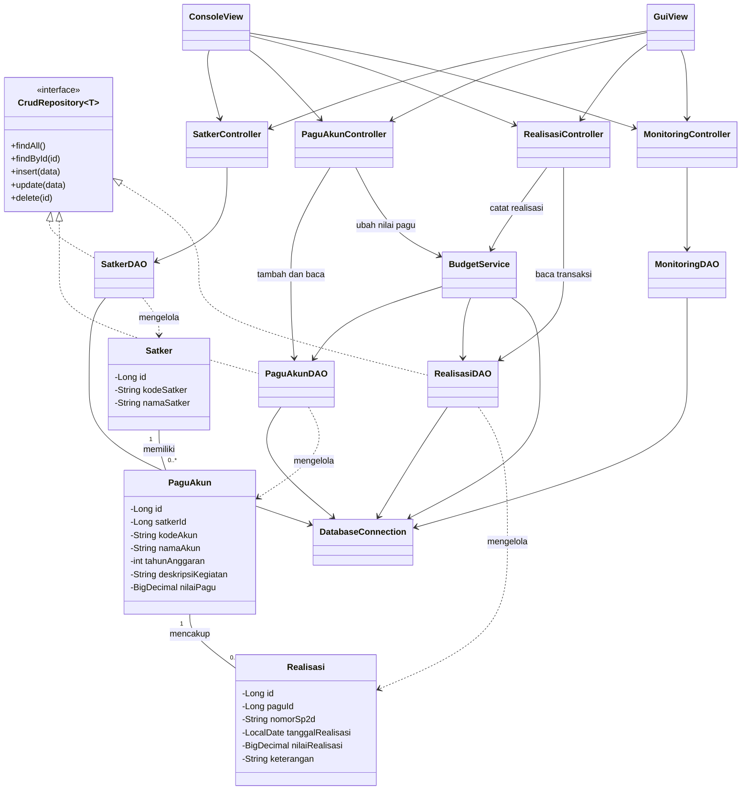
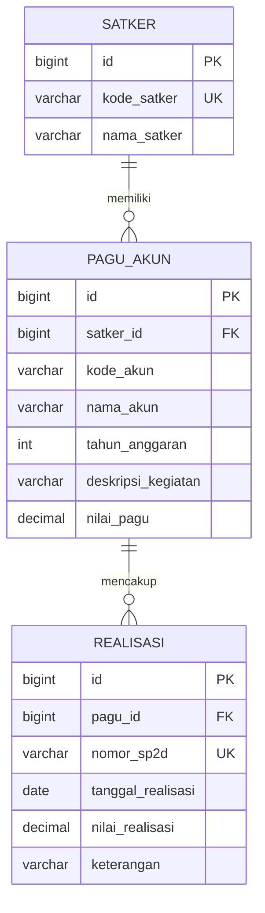

# Panduan Capstone Topik B — H2 untuk Pemula

**Aplikasi:** Monitoring Realisasi Anggaran Satker  
**Versi:** 1.5 · revisi dataset Suku Dinas · 15 Oktober 2026  
**Skenario demo:** simulasi Suku Dinas Pertamanan dan Hutan Kota DKI Jakarta, dari `setup_demo1.sql`  
**Tim:** At, Al, W, C, R  
**Alat:** NetBeans, JDK 25, Maven, JDBC, H2 berbasis file  
**Deadline disetujui:** **Jumat, 16 Oktober 2026 pukul 23.00 WIB**  
**Target kirim:** Jumat pukul 22.30 WIB · **Modul insight AI:** khusus R, setelah aplikasi utama berjalan.

## Mulai di Sini

1. Baca bagian **1–2** untuk memahami tujuan dan alur aplikasi.
2. Ikuti bagian **7** satu tahap demi satu tahap. Setiap tahap mempunyai tugas, petunjuk dan tanda selesai.
3. Buka bagian **3–6** sebagai contoh ketika membutuhkan struktur folder, class atau database. Gunakan bagian **8 dan 12** untuk memeriksa hasil.

**Sasaran pertama:** jalankan `MainConsole`, buat satu object `Satker`, lalu tampilkan kode dan namanya. Bangun fitur berikutnya setelah sasaran kecil ini berhasil. Panduan ini memberi arah dan contoh sintaks; anggota menulis serta memahami kode aplikasinya sendiri.

**Langsung praktik:** [7.1 Proyek](#71-buat-dan-jalankan-proyek--semua-anggota) → [7.2 Object](#72-buat-satu-object-satker--at-dicoba-semua-anggota) → [7.3 Koneksi](#73-hubungkan-java-ke-h2--al) → [7.4 Tabel](#74-buat-tabel-dan-data-dummy--at-dan-al) → [7.5 CRUD](#75-baca-satker-lalu-lengkapi-crud--al-w-dan-c) → [7.6 Pagu](#76-tambahkan-pagu--at-al-dan-w) → [7.7 Realisasi](#77-catat-realisasi-dan-jaga-sisa-pagu--at-al-dan-w) → [7.8 Rekap](#78-buat-rekap-dan-uji--al-w-c-dan-r).

**Perubahan utama:** H2 menyimpan database dalam file dan berjalan bersama aplikasi Java. Untuk panduan ini, XAMPP dan server database terpisah tidak diperlukan. [H2 embedded](https://h2database.com/html/quickstart.html)

**Catatan kesesuaian:** soal capstone awal menyebut MySQL atau PostgreSQL. Panduan ini mengikuti keputusan tim memakai H2; persetujuan pengajar untuk perubahan database belum tercatat di percakapan. Catat keputusan dan status kesesuaiannya di laporan. Persetujuan deadline pukul 23.00 WIB tetap berlaku.

## Daftar Isi

1. [Memahami Aplikasi](#1-memahami-aplikasi)
2. [Alur Program dan Istilah](#2-alur-program-dan-istilah)
3. [Folder, Package dan Class](#3-folder-package-dan-class)
4. [Desain Kelas](#4-desain-kelas)
5. [Hubungan Antarkelas](#5-hubungan-antarkelas)
6. [Database H2](#6-database-h2)
7. [Langkah Pembangunan dari Nol](#7-langkah-pembangunan-dari-nol)
8. [Aturan Bisnis Singkat](#8-aturan-bisnis-singkat)
9. [Impor CSV dan Error Penting](#9-impor-csv-dan-error-penting)
10. [AI Khusus R](#10-ai-khusus-r)
11. [Pembagian Tugas dan Jadwal](#11-pembagian-tugas-dan-jadwal)
12. [Pengujian dan Penyerahan](#12-pengujian-dan-penyerahan)

## 1. Memahami Aplikasi

Petugas ingin mengetahui anggaran yang tersedia, pengeluaran yang sudah dicatat dan sisa uang yang masih dapat digunakan.

| Istilah | Arti sederhana |
| --- | --- |
| Satker | Unit kerja yang mempunyai anggaran. |
| Akun | Kode kelompok belanja. |
| Pagu | Batas anggaran untuk Satker, akun, tahun dan kegiatan tertentu. |
| Realisasi | Pengeluaran yang sudah dicatat. |
| Nomor SP2D | Nomor dokumen pengeluaran; dipakai sebagai identitas unik transaksi pada demo. |
| Monitoring/rekap | Ringkasan total pagu, realisasi, sisa dan persen. |

**Skenario yang dipakai:** data Suku Dinas Pertamanan dan Hutan Kota dari `setup_demo1.sql`, termasuk nama unit, kode Satker, akun belanja, kegiatan, nomor SP2D dan keterangan pengeluaran. Seluruhnya tetap data simulasi untuk latihan.

**Contoh untuk memahami proses:** sebuah unit perawatan taman mempunyai pagu Rp1.000.000. Pengeluaran Rp250.000 membuat sisanya Rp750.000 dan persentasenya 25%. Pengeluaran berikutnya Rp800.000 harus ditolak. Ini ilustrasi sederhana; angka dataset Suku Dinas dijelaskan pada bagian 6 dan 8.4.

Urutan kegiatan pengguna:

```text
Daftarkan Satker -> Tambahkan pagu -> Catat realisasi -> Lihat sisa dan persen
```

Lima fitur utama yang harus berjalan:

1. Tambah, lihat, ubah dan hapus Satker — disebut **CRUD**.
2. Tambah, lihat dan kelola pagu akun.
3. Catat dan lihat realisasi dengan nomor SP2D.
4. Tolak realisasi yang melebihi sisa pagu.
5. Tampilkan rekap per Satker dan per akun.

Semua data harus dummy. Console menjadi tampilan pertama. Impor CSV, dashboard, ranking, rekap periode, Swing dan AI dikerjakan sesudah fitur utama lulus uji.

## 2. Alur Program dan Istilah

Bayangkan pengguna memilih menu **Tambah Satker**. Setiap bagian mempunyai tugas berikut.

| Bagian | Tugas sederhana | Contoh dalam aplikasi |
| --- | --- | --- |
| Main | Menyiapkan bagian aplikasi dan memulai menu. | `MainConsole` |
| View | Bertanya kepada pengguna dan menampilkan hasil. | `ConsoleView` meminta kode/nama. |
| Controller | Memeriksa input dan mengatur urutan pekerjaan. | `SatkerController` menolak nama kosong. |
| Model | Menampung satu data dalam object Java. | `Satker` menyimpan kode/nama. |
| DAO | Mengirim perintah baca/tulis ke database. | `SatkerDAO` menyimpan Satker. |
| Database | Menyimpan data agar tetap ada setelah program ditutup. | File H2 lokal. |
| Service | Menjalankan aturan bisnis yang perlu beberapa operasi. | `BudgetService` memeriksa sisa sebelum menyimpan realisasi. |
| Util | Membantu pekerjaan yang dipakai bersama. | `DatabaseConnection` membuka koneksi. |

Alur normal:

```text
ConsoleView -> Controller -> DAO -> H2
```

Alur pencatatan realisasi atau perubahan nilai pagu:

```text
ConsoleView -> Controller -> BudgetService -> DAO -> H2
```

Hasil kembali ke View melalui Controller. Model membawa datanya. Istilah **MVC** merujuk pada pemisahan Model, View dan Controller; **DAO** berarti bagian khusus akses data; **JDBC** adalah API Java untuk berkomunikasi dengan database.

**Alternatif desain:** menaruh menu, SQL dan perhitungan dalam satu class mudah dimulai, tetapi menyulitkan pembagian tugas dan pengujian. Tim memilih pemisahan di atas agar tugas setiap class jelas.

Sebelum menulis sebuah method, tulis dahulu: **input apa → dikerjakan apa → hasil apa**. Contoh `findAll()`: tidak menerima filter → membaca Satker → mengembalikan `List<Satker>`.

Saat buntu, simpan percobaan kode dan pesan error persisnya. Minta satu petunjuk atau penjelasan sintaks, perbaiki sendiri, lalu jalankan ulang. Contoh permintaan bantuan: “Jelaskan penyebab error ini dan beri satu petunjuk; biarkan saya menulis perbaikannya.”

## 3. Folder, Package dan Class

Versi ini memakai **satu proyek Maven bernama `capstone-anggaran`**. Folder `core-app` pada panduan lama menjadi folder proyek ini; folder tambahan di luarnya tidak diperlukan untuk latihan lokal.

### 3.1 Apa yang Dibuat di NetBeans?

- **Folder** menyimpan file di komputer, misalnya `database` dan `config`.
- **Package** memberi nama kelompok class Java, misalnya `id.capstone.anggaran.model`.
- **Class** adalah isi file Java, misalnya class `Satker` dalam `Satker.java`.

Di NetBeans, **Source Packages** adalah tampilan package Java. Tampilan **Files** memperlihatkan folder sebenarnya.

```text
Package : id.capstone.anggaran.model
Folder  : src/main/java/id/capstone/anggaran/model/
Class   : Satker
File    : Satker.java
```

Cara membuat package: klik kanan **Source Packages → New → Java Package**. Prefix `id.capstone.anggaran` tetap sama; ganti bagian akhirnya:

```text
id.capstone.anggaran.model
id.capstone.anggaran.dao
id.capstone.anggaran.controller
id.capstone.anggaran.view.console
id.capstone.anggaran.util
id.capstone.anggaran.service
id.capstone.anggaran.exception
```

Lalu klik kanan package yang sesuai → **New → Java Class**. Saat membuat `Satker` dalam package model, NetBeans menambahkan `package id.capstone.anggaran.model;`. Untuk memakai class itu dari package lain, tulis `import id.capstone.anggaran.model.Satker;`.

### 3.2 Peta Folder Akhir

**Buat file sesuai tahap pada bagian 7.** Peta ini adalah tujuan akhir, bukan daftar file kosong yang harus dibuat sekaligus.

```text
capstone-anggaran/                 <- buka folder ini sebagai proyek NetBeans
|-- pom.xml                       <- pengaturan Maven dan library
|-- src/
|   |-- main/java/id/capstone/anggaran/
|   |   |-- MainConsole.java       <- tempat main() dan awal program
|   |   |-- model/
|   |   |   |-- Satker.java
|   |   |   |-- PaguAkun.java
|   |   |   |-- Realisasi.java
|   |   |   `-- MonitoringRow.java
|   |   |-- dao/
|   |   |   |-- CrudRepository.java
|   |   |   |-- SatkerDAO.java
|   |   |   |-- PaguAkunDAO.java
|   |   |   |-- RealisasiDAO.java
|   |   |   `-- MonitoringDAO.java
|   |   |-- controller/
|   |   |   |-- SatkerController.java
|   |   |   |-- PaguAkunController.java
|   |   |   |-- RealisasiController.java
|   |   |   `-- MonitoringController.java
|   |   |-- view/console/ConsoleView.java
|   |   |-- service/BudgetService.java
|   |   |-- util/DatabaseConnection.java
|   |   |-- util/SetupDatabase.java <- dijalankan manual untuk setup/reset
|   |   `-- exception/PaguExceededException.java
|   `-- test/java/id/capstone/anggaran/
|-- config/db.properties.example
|-- config/db.properties           <- dibuat lokal dari contoh
|-- database/setup_demo_h2.sql
|-- data/                         <- file database dibuat H2
|-- imports/import_satker_sudin.csv
|-- imports/import_pagu_akun_sudin.csv
|-- docs/buglog.md
|-- laporan/
`-- README.md
```

Tambahkan `CsvImporter` ketika mengerjakan impor. Folder `view/gui`, `MainGui`, `spi` dan proyek plugin AI dibuat hanya ketika tambahan tersebut dikerjakan.

Setiap anggota mempunyai salinan proyek dan file H2 sendiri. Data baru di komputer At tidak otomatis muncul di komputer Al. Untuk latihan lokal, buka salinan proyek melalui NetBeans; untuk pengumpulan tim, tetap sediakan tautan repository sesuai ketentuan capstone. Saat berbagi kode, sertakan SQL dan konfigurasi contoh; keluarkan konfigurasi aktual, `data/`, `target/` dan model AI.

## 4. Desain Kelas

### 4.1 Kelas Model

Class adalah cetakan; object adalah satu data yang dibuat dari cetakan tersebut. Contohnya, `Satker` adalah cetakan dan Satker dengan kode `3.27.01.01` adalah salah satu object-nya.

Seluruh atribut domain bersifat `private`. Akses atribut dilakukan melalui getter dan setter yang sesuai.

| Kelas | Atribut utama | Tanggung jawab |
| --- | --- | --- |
| Satker | `id`, `kodeSatker`, `namaSatker` | Merepresentasikan data Satker. |
| PaguAkun | `id`, `satkerId`, `kodeAkun`, `namaAkun`, `tahunAnggaran`, `deskripsiKegiatan`, `nilaiPagu` | Merepresentasikan pagu untuk suatu akun dan kegiatan. |
| Realisasi | `id`, `paguId`, `nomorSp2d`, `tanggalRealisasi`, `nilaiRealisasi`, `keterangan` | Merepresentasikan transaksi realisasi. |

Nilai uang menggunakan `BigDecimal` untuk menjaga ketelitian perhitungan. Tanggal menggunakan `LocalDate`, sedangkan ID menggunakan `Long`.

Contoh mengikuti v1.0, dengan konstruktor untuk mengisi data. Simpan sebagai `model/Satker.java` di dalam package `id.capstone.anggaran.model`:

```java
package id.capstone.anggaran.model;

public class Satker {
    private Long id;
    private String kodeSatker;
    private String namaSatker;

    public Satker() {
    }

    public Satker(Long id, String kodeSatker, String namaSatker) {
        this.id = id;
        this.kodeSatker = kodeSatker;
        this.namaSatker = namaSatker;
    }

    public Long getId() {
        return id;
    }

    public String getKodeSatker() {
        return kodeSatker;
    }

    public void setKodeSatker(String kodeSatker) {
        this.kodeSatker = kodeSatker;
    }

    public String getNamaSatker() {
        return namaSatker;
    }

    public void setNamaSatker(String namaSatker) {
        this.namaSatker = namaSatker;
    }
}
```

Pola enkapsulasi yang sama diterapkan pada `PaguAkun` dan `Realisasi`. Setter hanya disediakan untuk atribut yang memang boleh diubah. Konstruktor tanpa argumen mendukung latihan membuat object lalu memakai setter; konstruktor dengan argumen mendukung pembacaan hasil query. `MonitoringRow` merupakan data hasil rekap, bukan tabel baru.

### 4.2 Interface dan Polimorfisme

Pelajari bagian ini setelah CRUD Satker berjalan. Interface adalah daftar operasi yang harus disediakan suatu class; polimorfisme berarti satu tipe interface dapat menunjuk ke implementasi yang sesuai.

Interface `CrudRepository<T>` menyediakan operasi akses data yang umum digunakan. Lima method mengikuti v1.0; `SQLException` dideklarasikan agar kegagalan JDBC dapat ditangani oleh pemanggil.

```java
import java.sql.SQLException;
import java.util.List;

public interface CrudRepository<T> {
    List<T> findAll() throws SQLException;
    T findById(long id) throws SQLException;
    void insert(T data) throws SQLException;
    void update(T data) throws SQLException;
    void delete(long id) throws SQLException;
}
```

Implementasi mengikuti pola v1.0:

```text
SatkerDAO implements CrudRepository<Satker>
PaguAkunDAO implements CrudRepository<PaguAkun>
RealisasiDAO implements CrudRepository<Realisasi>
```

**Pembatasan RealisasiDAO:** walaupun mengikuti interface CRUD seperti v1.0, `update()` dan `delete()` harus menolak operasi dengan `UnsupportedOperationException`. Controller realisasi hanya menyediakan pencatatan dan pembacaan transaksi.

Contoh penggunaan polimorfisme:

```java
CrudRepository<Satker> repository =
        new SatkerDAO(connection);

List<Satker> daftarSatker = repository.findAll();
```

Variabel `repository` menggunakan tipe interface, tetapi pemanggilan method dijalankan oleh implementasi `SatkerDAO`. Dengan demikian, interface digunakan dalam kode, bukan sekadar dideklarasikan.

### 4.3 Kelas DAO

| Kelas | Tanggung jawab |
| --- | --- |
| SatkerDAO | CRUD Satker melalui JDBC. |
| PaguAkunDAO | Menambah, melihat dan mengubah pagu; penghapusan mengikuti integritas referensial. |
| RealisasiDAO | Menambah dan melihat transaksi realisasi serta menghitung total realisasi; menolak update dan delete. |
| MonitoringDAO | Mengambil data monitoring dan rekap berdasarkan periode. |

Seluruh query dijalankan menggunakan `PreparedStatement`. Nilai input tidak boleh digabungkan langsung ke string SQL. Dalam transaksi anggaran, DAO memakai koneksi yang diberikan `BudgetService`.

### 4.4 Kelas Controller

| Kelas | Tanggung jawab |
| --- | --- |
| SatkerController | Memvalidasi dan mengatur CRUD Satker. |
| PaguAkunController | Memvalidasi dan mengatur pengelolaan pagu; memakai BudgetService untuk perubahan nilai pagu. |
| RealisasiController | Memvalidasi dan mencatat realisasi melalui BudgetService; menangani pelanggaran pagu. |
| MonitoringController | Mengambil data monitoring, menyiapkan rekap, dashboard, ranking dan insight AI opsional. |

Controller menangani input dari View dan mengembalikan hasil atau pesan kesalahan yang dapat dipahami pengguna.

### 4.5 Kelas Utilitas dan Exception

- **DatabaseConnection:** membaca konfigurasi dan menyediakan koneksi JDBC.
- **SetupDatabase:** menjalankan SQL setup/reset secara manual; tidak dipanggil oleh menu aplikasi.
- **PaguExceededException:** exception khusus ketika pencatatan realisasi melampaui sisa pagu.
- **MainConsole:** menjalankan aplikasi Console.
- **MainGui:** menjalankan GUI Swing jika fitur ini dibangun.

Pendukung tambahan yang tetap dibatasi:

- **BudgetService:** mengunci pagu, memeriksa sisa dan menjalankan commit atau rollback.
- **CsvImporter:** memeriksa dan menyimpan data CSV melalui DAO.
- **MonitoringRow:** menampung kode Satker, pagu, realisasi, sisa dan persen hasil rekap.

Kontrak AI dijelaskan pada bagian 10 dan dikerjakan oleh R.

## 5. Hubungan Antarkelas

Mulai dari empat hubungan data berikut, sama seperti v1.0:

1. Satu Satker dapat memiliki banyak pagu akun.
2. Satu pagu akun dapat memiliki banyak transaksi realisasi.
3. Setiap pagu akun terhubung ke satu Satker.
4. Setiap transaksi realisasi terhubung ke satu pagu akun.

```text
Satker (1) -> PaguAkun (banyak)
PaguAkun (1) -> Realisasi (banyak)
```

Pada class anak, `satkerId` atau `paguId` menyimpan ID induknya. Pada database, hubungan yang sama dijaga oleh foreign key. Diagram lengkap berikut mempertahankan class dan pola v1.0; gunakan saat menyatukan modul.

<details>
<summary>Diagram kelas lengkap — buka saat membutuhkan gambaran integrasi</summary>



</details>

Angka `0..*` berarti nol atau banyak. Panah penuh berarti memakai class lain; garis putus dengan segitiga berarti menerapkan interface. `GuiView` adalah tambahan opsional. `RealisasiDAO` mengikuti interface seperti v1.0, tetapi menolak update/delete.

## 6. Database H2

### 6.1 Pengaturan yang Dipakai Bersama

Tim menggunakan H2 **embedded berbasis file**: H2 berjalan di dalam proses Java. File data berada pada komputer masing-masing dan bertahan setelah program ditutup. URL relatif dihitung dari folder kerja program. [Mode dan lokasi database H2](https://h2database.com/html/features.html#database_url)

Gunakan **H2 2.2.224** yang tersedia untuk latihan dan pengujian panduan ini; seluruh anggota memakai versi yang sama. Tambahkan di bagian `<dependencies>` pada `pom.xml`:

```xml
<dependency>
    <groupId>com.h2database</groupId>
    <artifactId>h2</artifactId>
    <version>2.2.224</version>
</dependency>
```

Al menyiapkan `pom.xml` sekali; anggota lain menggunakan salinan yang sama. Jika proyek baru belum mempunyai pengaturan Maven yang sesuai, gunakan contoh minimal berikut sebagai acuan konfigurasi.

<details>
<summary>Al: contoh pom.xml minimal untuk satu proyek NetBeans</summary>

```xml
<project xmlns="http://maven.apache.org/POM/4.0.0"
         xmlns:xsi="http://www.w3.org/2001/XMLSchema-instance"
         xsi:schemaLocation="http://maven.apache.org/POM/4.0.0 https://maven.apache.org/xsd/maven-4.0.0.xsd">
    <modelVersion>4.0.0</modelVersion>
    <groupId>id.capstone</groupId>
    <artifactId>capstone-anggaran</artifactId>
    <version>1.0-SNAPSHOT</version>
    <properties>
        <maven.compiler.release>25</maven.compiler.release>
        <project.build.sourceEncoding>UTF-8</project.build.sourceEncoding>
        <exec.mainClass>id.capstone.anggaran.MainConsole</exec.mainClass>
    </properties>
    <dependencies>
        <dependency>
            <groupId>com.h2database</groupId>
            <artifactId>h2</artifactId>
            <version>2.2.224</version>
        </dependency>
    </dependencies>
    <build>
        <plugins>
            <plugin>
                <groupId>org.apache.maven.plugins</groupId>
                <artifactId>maven-compiler-plugin</artifactId>
                <version>3.16.0</version>
            </plugin>
        </plugins>
    </build>
</project>
```

</details>

Salin `config/db.properties.example` menjadi `config/db.properties`:

```properties
db.url=jdbc:h2:file:./data/monitoring_anggaran
db.user=sa
db.password=
```

`sa` dan password kosong adalah konfigurasi database latihan baru pada panduan ini. `DatabaseConnection.getConnection()` membaca file tersebut dengan `Properties`, lalu memanggil `DriverManager.getConnection(url, user, password)`. Setiap pemanggilan menghasilkan koneksi baru yang ditutup oleh pemanggil.

H2 membuat file `data/monitoring_anggaran.mv.db`; nama file itu tidak ditambahkan pada URL JDBC. Koneksi pertama membuat database kosong, **belum membuat tiga tabel**. Tabel/data dibuat melalui setup pada tahap 7.4. Untuk melihat file database dari alat lain, tutup aplikasi dahulu agar file tidak sedang dipakai oleh dua proses.

### 6.2 Diagram Database

`PK` adalah ID unik setiap baris; `FK` menghubungkan anak ke induk; `UK` berarti nilainya harus unik.



### 6.3 SQL dan Data Awal

Salin [lampiran setup_demo_h2.sql](setup_demo_h2.sql) ke folder `database/`. Sumbernya adalah **`setup_demo1.sql` versi Suku Dinas**, berisi 12 Satker, 26 pagu dan 52 realisasi simulasi. Konversi ke H2 mempertahankan seluruh nama unit, kode, akun, kegiatan, SP2D, tanggal, nominal dan keterangan sumber; penyesuaian dilakukan pada sintaks database dan pengaturan ID otomatis.

Contoh Satker pertama: `3.27.01.01` — Sudin Pertamanan dan Hutan Kota Kota Adm. Jakarta Pusat. Pagu pertamanya memakai akun `510201` untuk belanja bahan bibit tanaman, pupuk dan operasional RTH. Gunakan dataset ini untuk mengikuti angka pembanding panduan.

Contoh tabel Satker pada H2:

```sql
CREATE TABLE satker (
    id BIGINT GENERATED BY DEFAULT AS IDENTITY PRIMARY KEY,
    kode_satker VARCHAR(20) NOT NULL UNIQUE,
    nama_satker VARCHAR(120) NOT NULL
);
```

Kolom identity menghasilkan ID otomatis. Saat menambah data biasa, jangan mengisi `id`. Lampiran memasukkan ID awal secara eksplisit dan menyetel ID berikutnya menjadi 13, 27 dan 53 agar insert berikutnya aman. Lampiran memakai sintaks H2 standar. [Sintaks kolom H2](https://h2database.com/html/grammar.html#column_definition), [pengaturan identity](https://h2database.com/html/commands.html#alter_table_alter_column)

Ketentuan tabel mengikuti v1.0: kode Satker unik; kombinasi Satker/akun/tahun/kegiatan unik; nomor SP2D unik; pagu tidak negatif; realisasi positif; penghapusan induk yang masih dipakai ditolak. Semua kolom wajib kecuali keterangan. Struktur lengkap dan ukuran kolom tersedia pada lampiran SQL.

**Setup menghapus dan membuat ulang tiga tabel. Jalankan manual saat setup/reset uji, bukan setiap aplikasi dibuka.**

## 7. Langkah Pembangunan dari Nol

Urutan ini dipakai untuk belajar dan memeriksa hasil. Dalam tim, anggota mengerjakan bagian sesuai perannya, lalu mencoba hasil yang sudah digabungkan. Sebelum lanjut, pastikan tanda selesai tahap sebelumnya terpenuhi.

### 7.1 Buat dan Jalankan Proyek — Semua Anggota

**Tujuan:** memastikan Java dan NetBeans dapat menjalankan program sederhana.

1. Pilih **File → New Project → Java with Maven → Java Application**.
2. Gunakan nama proyek `capstone-anggaran`, Group ID `id.capstone`, Artifact ID `capstone-anggaran`, version `1.0-SNAPSHOT`, package `id.capstone.anggaran`.
3. Simpan pada folder lokal pilihan anggota. Buka folder proyek yang berisi `pom.xml`.
4. Pastikan JDK 25 terdaftar pada **Tools → Java Platforms**. Di `pom.xml`, atur `maven.compiler.release` ke `25` dan encoding ke `UTF-8`; Al menyiapkan Maven Compiler Plugin `3.16.0` untuk tim.
5. Buat `MainConsole` pada package `id.capstone.anggaran`, tambahkan `main()` dan cetak satu kalimat. Jadikan class ini sebagai main class saat NetBeans meminta pilihan.
6. Klik kanan proyek → **Clean and Build**, kemudian **Run**. Maven mengunduh library saat pertama diperlukan.

**Petunjuk sintaks:** `public static void main(String[] args)` adalah titik mulai; `System.out.println(...)` menampilkan teks. **Selesai jika:** kalimat tampil dan build berhasil.

### 7.2 Buat Satu Object Satker — At; Dicoba Semua Anggota

**Tujuan:** memahami perbedaan class, object dan atribut sebelum memakai database.

1. Buat package `id.capstone.anggaran.model`, kemudian class `Satker` seperti bagian 4.1.
2. Pelajari tiga field: ID, kode dan nama. `private` membuat field diakses melalui method.
3. Di `MainConsole`, import `Satker`, buat object, isi kode/nama dengan setter dan tampilkan melalui getter.
4. Ulangi dengan object kedua dan perhatikan bahwa keduanya menyimpan nilai sendiri.

**Petunjuk sintaks:** `new Satker()` membuat object; `setNamaSatker(...)` mengisi nama; `getNamaSatker()` mengembalikannya. `main()` tetap berada pada `MainConsole`. **Selesai jika:** dua Satker menampilkan kode/nama berbeda dan anggota dapat menjelaskan `this` serta getter/setter.

### 7.3 Hubungkan Java ke H2 — Al

**Tujuan:** membuka dan menutup koneksi database lokal.

1. Tambahkan dependency H2 pada `pom.xml` seperti bagian 6.1, kemudian build kembali.
2. Melalui tampilan **Files**, buat folder biasa `config`, `data` dan `database` di samping `pom.xml`.
3. Buat file konfigurasi contoh dan salinan aktualnya seperti bagian 6.1.
4. Buat package `util` dan class `DatabaseConnection` dengan method `getConnection()`.
5. Dari `MainConsole`, panggil method tersebut dalam `try-with-resources` dan cetak pesan berhasil setelah koneksi terbuka.

**Petunjuk sintaks:** `Properties`, `Path`, `DriverManager`, `Connection`, `try (...)`. **Selesai jika:** koneksi berhasil dan file H2 muncul pada folder `data` proyek. Bila file muncul di tempat lain, cetak `Path.of("").toAbsolutePath()` dan periksa folder kerja.

### 7.4 Buat Tabel dan Data Dummy — At dan Al

**Tujuan:** database berisi tiga tabel yang sama pada semua komputer.

1. Salin lampiran SQL ke `database/setup_demo_h2.sql`.
2. Buat helper `util/SetupDatabase.java` dengan `main()` khusus untuk setup manual.
3. Gunakan `DatabaseConnection.getConnection()` dan `org.h2.tools.RunScript.execute(connection, reader)` untuk membaca file SQL sebagai UTF-8. Tutup Reader dan Connection dengan `try-with-resources`.
4. Klik kanan `SetupDatabase.java` → **Run File** satu kali. Setelahnya, jalankan kembali `MainConsole` sebagai aplikasi normal.
5. Periksa jumlah baris menggunakan tiga query `SELECT COUNT(*) FROM satker`, `pagu_akun` dan `realisasi`.

**Selesai jika:** jumlahnya **12, 26, 52**. Helper tidak dipanggil oleh `MainConsole`. H2 menyediakan `RunScript` untuk menjalankan file SQL; helper ini hanya alat setup. [Menjalankan skrip H2](https://h2database.com/html/tutorial.html#using_the_script_tool)

### 7.5 Baca Satker, Lalu Lengkapi CRUD — Al, W dan C

**Tujuan:** satu fitur lengkap bekerja dari menu sampai database.

1. Buat `SatkerDAO(Connection connection)`. Kerjakan `findAll()` dahulu: query → baca setiap baris → buat object `Satker` → masukkan ke `List<Satker>`.
2. Dari `MainConsole`, coba tampilkan daftar hasilnya. Setelah berhasil, tambah `findById()`, `insert()`, `update()` dan `delete()` satu per satu.
3. W membuat `SatkerController`: periksa input, panggil DAO dan kembalikan hasil/pesan.
4. C membuat `ConsoleView`: menu Tambah/Lihat/Ubah/Hapus/Kembali. `MainConsole` menyiapkan dan menghubungkan objek-objek tersebut.
5. Setelah operasi berjalan, buat interface `CrudRepository<T>` dari bagian 4.2 dan gunakan melalui variabel bertipe interface.

**Petunjuk sintaks:** `List`, `ArrayList`, `while (rs.next())`, `PreparedStatement`, parameter `?`, `executeQuery()` untuk SELECT dan `executeUpdate()` untuk perubahan. Input pengguna tidak digabungkan ke SQL.

**Selesai jika:** satu Satker baru dapat dibuat, dilihat, diubah dan dihapus. Kode duplikat dan penghapusan Satker yang sudah mempunyai pagu ditolak. Data baru masih ada setelah aplikasi ditutup dan dibuka lagi.

### 7.6 Tambahkan Pagu — At, Al dan W

**Tujuan:** pengguna dapat memberi anggaran kepada Satker yang sudah ada.

1. At membuat `PaguAkun` sesuai bagian 4.1; Al membuat DAO; W membuat Controller; C menambahkan menu.
2. Pengguna memilih Satker yang valid lalu mengisi akun, nama akun, tahun, kegiatan dan nilai pagu.
3. Tolak kolom wajib kosong, nilai negatif dan kombinasi data yang duplikat.
4. Sediakan tambah/lihat serta ubah/hapus sesuai aturan bagian 8. Perubahan nilai pagu diproses melalui `BudgetService` agar aman saat realisasi sudah ada.

**Petunjuk sintaks:** `new BigDecimal("1000000.00")`, `setBigDecimal()` dan `getBigDecimal()`. Buat uang dari teks; bandingkan nilainya dengan `compareTo()`. **Selesai jika:** pagu terhubung ke Satker yang benar dan nilai uang tersimpan tepat.

Untuk input nominal pada menu, gunakan `1000000.00` tanpa tulisan Rp atau pemisah ribuan. Format rupiah digunakan saat menampilkan hasil.

### 7.7 Catat Realisasi dan Jaga Sisa Pagu — At, Al dan W

**Tujuan:** pengeluaran tersimpan hanya jika masih ada anggaran.

1. Buat model/DAO/Controller `Realisasi`, lalu menu untuk memilih pagu, nomor SP2D, tanggal, nilai dan keterangan.
2. W membuat satu `BudgetService`; Al menyediakan query penguncian pagu dan penjumlahan realisasi.
3. Jalankan pemeriksaan dan penyimpanan dalam satu transaksi seperti bagian 8.3.
4. Buat `PaguExceededException`. Controller mengubah error menjadi pesan yang menyebut sisa pagu.
5. Sediakan menu tambah dan lihat realisasi. Realisasi tersimpan tidak dapat diedit/dihapus.

**Petunjuk sintaks:** `LocalDate.parse()`, `throw`, `try/catch`, `setAutoCommit(false)`, `commit()`, `rollback()`. **Selesai jika:** pada data awal `pagu_id=1`, Rp7.200.000 diterima dan Rp1 sesudah itu ditolak. Ulangi dari setup baru untuk setiap skenario angka.

### 7.8 Buat Rekap dan Uji — Al, W, C dan R

**Tujuan:** pengguna dapat melihat angka yang benar dan aplikasi tetap berjalan saat input salah.

1. `MonitoringDAO` membaca total per pagu, kemudian per Satker dan akun; jangan menghitung pagu berulang akibat banyak transaksi.
2. `MonitoringController` mengolah hasil menggunakan `List` atau `Map`; `MonitoringRow` menampung satu baris ringkasan.
3. View menampilkan pagu, realisasi, sisa dan persen. Jika pagu nol, tampilkan 0%.
4. R menyiapkan JUnit untuk perhitungan/validasi; semua anggota menjalankan checklist bagian 12, mencoba input salah dan menggunakan breakpoint saat hasil meleset.

**Selesai jika:** hasil sesuai bagian 8.4, data bertahan setelah restart dan fitur utama berjalan tanpa plugin AI. Setelah tahap ini, kerjakan tambahan yang dipilih tim.

## 8. Aturan Bisnis Singkat

### 8.1 Satker dan Pagu

1. Kode/nama Satker wajib; kode harus unik. Hapus Satker hanya jika tidak mempunyai pagu.
2. Pagu harus mempunyai Satker yang valid; akun, nama akun, tahun dan kegiatan wajib. Nilainya nol atau positif.
3. Kombinasi Satker + akun + tahun + kegiatan harus unik. Hapus pagu hanya jika tidak mempunyai realisasi.
4. Nilai pagu baru tidak boleh lebih kecil dari total realisasi. Satker, akun, tahun dan kegiatan pada pagu yang sudah mempunyai realisasi tidak boleh diganti.

### 8.2 Realisasi dan Monitoring

1. Pilih pagu yang valid. SP2D wajib dan unik; tanggal valid berformat `yyyy-MM-dd`; nominal lebih dari nol. Keterangan boleh kosong.
2. Semua nilai uang memakai `BigDecimal`, maksimal dua angka desimal dan sesuai `DECIMAL(18,2)` — paling banyak 16 digit sebelum koma.
3. Realisasi baru ≤ sisa pagu. Realisasi yang sudah disimpan hanya dapat dibaca.
4. Sisa = pagu − total realisasi. Persen = total realisasi ÷ pagu × 100; jika pagu nol, hasil 0%.
5. Untuk rekap gabungan, jumlahkan nilai uang terlebih dahulu, lalu hitung persen. Pembulatan persen `HALF_UP` dua desimal dilakukan untuk tampilan.
6. Demo memakai satu SP2D unik untuk satu pagu. Dokumen dengan beberapa akun memerlukan desain header/detail pada pengembangan berikutnya.

### 8.3 Transaksi Aman — Petunjuk untuk Al dan W

Transaksi berarti beberapa pekerjaan database dianggap satu kesatuan: **commit** menyimpan semuanya, **rollback** membatalkan perubahan yang belum di-commit.

1. Buka satu koneksi, gunakan isolation `READ_COMMITTED`, lalu `setAutoCommit(false)`.
2. Kunci pagu menggunakan `SELECT nilai_pagu FROM pagu_akun WHERE id = ? FOR UPDATE`.
3. Setelah kunci diperoleh, hitung total realisasi pada koneksi yang sama.
4. Periksa nominal terhadap sisa. Jika valid, insert lalu commit; jika gagal, rollback.
5. Perubahan nilai pagu memakai kunci yang sama. DAO menerima koneksi milik `BudgetService`; DAO tidak membuka koneksi lain, commit atau menutup koneksi tersebut.

`SELECT ... FOR UPDATE` mengunci baris pagu sampai commit/rollback, sehingga dua pencatatan tidak memakai sisa lama secara bersamaan. [Penguncian H2](https://h2database.com/html/features.html#locking_lock_timeout_deadlocks)

### 8.4 Angka Pembanding

Mulai dari lampiran SQL yang bersih. Semua nominal di bawah dalam rupiah.

| Filter | Pagu | Realisasi | Sisa | Persen |
| --- | ---: | ---: | ---: | ---: |
| Semua Satker, 2026 | 4.050.000.000 | 1.798.750.000 | 2.251.250.000 | 44,41% |
| Sudin Jakarta Pusat — 3.27.01.01, 2026 | 200.000.000 | 188.000.000 | 12.000.000 | 94,00% |
| Akun 510201, 2026 | 2.430.000.000 | 1.079.250.000 | 1.350.750.000 | 44,41% |
| Akun 510203, 2026 | 1.620.000.000 | 719.500.000 | 900.500.000 | 44,41% |
| Semua Satker, 2025 | 140.000.000 | 92.800.000 | 47.200.000 | 66,29% |

Khusus `pagu_id=1`: pagu Rp120.000.000, realisasi Rp112.800.000, sisa Rp7.200.000.

Tambahan rekap bulanan/tahunan memakai bulan/tahun **tanggal realisasi**; filter **tahun anggaran** memakai data pagu. Dashboard menampilkan progress bar 20 karakter dan Top 5/10 menurut persen sebelum pembulatan, ASC/DESC, filter tahun, serta kode Satker ASC untuk nilai seri. Bila jumlah data kurang dari N, tampilkan yang tersedia. Serapan tidak langsung menunjukkan kualitas kinerja.

## 9. Impor CSV dan Error Penting

### 9.1 Impor — Dikerjakan Setelah Input Manual Berhasil

Impor berarti membaca banyak baris dari file lalu menyimpannya. Untuk skenario Suku Dinas, gunakan [import_satker_sudin.csv](import_satker_sudin.csv) **dahulu**, kemudian [import_pagu_akun_sudin.csv](import_pagu_akun_sudin.csv). Salin keduanya ke folder `imports/`.

Kedua lampiran tambahan mempertahankan jumlah baris dan nominal contoh impor awal, dengan kode/nama unit latihan serta akun/kegiatan yang diselaraskan dengan skenario pertamanan. Lima unit tambahan berkode `3.27.01.12`–`3.27.01.16` adalah unit simulasi, bukan daftar unit resmi. File CSV asli tetap tersedia sebagai bahan awal.

```text
Header Satker:
kode_satker,nama_satker

Header pagu:
kode_satker,kode_akun,nama_akun,tahun_anggaran,deskripsi_kegiatan,nilai_pagu
```

W membuat `CsvImporter`; Al membantu transaksi dan C menambah menu. Gunakan `org.apache.commons:commons-csv:1.14.1` untuk membaca UTF-8, BOM opsional, pemisah koma dan teks berkutip. Nominal file memakai titik desimal tanpa pemisah ribuan.

1. Periksa semua baris, header, format dan duplikat. Tampilkan nomor baris bermasalah; jika ada error, file tidak disimpan.
2. Jika valid, tampilkan ringkasan dan minta pengguna memilih Lanjut/Batal. Untuk pagu, cari ID Satker melalui kodenya.
3. Simpan **satu file dalam satu transaksi**. Bila satu baris gagal saat penyimpanan, rollback seluruh file.
4. Impor hanya menambah data; duplikat dalam file/database ditolak. Mengimpor ulang harus gagal tanpa menambah data. File Satker dan pagu adalah dua transaksi terpisah.

| Tahap | Satker | Pagu | Realisasi |
| --- | ---: | ---: | ---: |
| Setup | 12 | 26 | 52 |
| Impor Satker selesai | 17 | 26 | 52 |
| Impor pagu selesai | 17 | 36 | 52 |

Pagu 2026 bertambah Rp900.000.000 menjadi Rp4.950.000.000; realisasi tetap Rp1.798.750.000, sisa Rp3.151.250.000 dan serapan 36,34%.

### 9.2 Cukup Tiga Kelompok Error

| Masalah | Yang dilakukan aplikasi |
| --- | --- |
| Input/file salah | Sebutkan field/nomor baris dan cara memperbaiki; kembali ke menu. |
| Pagu terlampaui | Tangani `PaguExceededException`, rollback dan tampilkan sisa. |
| Duplikat, FK atau kegagalan database | Tangani `SQLException`, rollback transaksi yang gagal dan tampilkan pesan sesuai masalah. Simpan detail teknis/SQLState tanpa password. |

Satu custom exception cukup:

```java
public class PaguExceededException extends RuntimeException {
    public PaguExceededException(String pesan) {
        super(pesan);
    }
}
```

Controller menangkap error yang relevan dan View menampilkan pesan. Statement/ResultSet ditutup dengan `try-with-resources`; pemilik koneksi yang menutup koneksi. Semua query Java menggunakan `PreparedStatement`; pilihan kolom/arah urut dipetakan ke daftar tetap yang ditentukan aplikasi.

### 9.3 Saat Baru Belajar H2

| Gejala | Periksa dahulu |
| --- | --- |
| Tidak ada driver yang sesuai | Dependency H2 sudah terunduh dan URL dimulai `jdbc:h2:`. |
| Tabel tidak ditemukan | Setup sudah dijalankan pada URL dan folder kerja yang sama. Koneksi baru saja berhasil belum berarti tabel sudah ada. |
| Database sedang dipakai | Tutup aplikasi kedua atau alat pembaca DB yang membuka file yang sama. |
| Data kembali ke awal setiap Run | Pastikan `SetupDatabase` tidak dipanggil oleh `MainConsole`. |
| Data hilang setelah program ditutup | Gunakan URL berbasis file di bagian 6.1. Periksa lokasi file; `jdbc:h2:mem:` dipakai hanya untuk tes sementara. |

## 10. AI Khusus R

Anggota lain dapat melewati bagian ini. Aplikasi utama tetap menghitung rekap dan berjalan tanpa JAR plugin atau model AI.

1. **Hasil yang dituju:** paling banyak tiga poin insight dari angka dummy — serapan tertinggi, terendah dan pertanyaan tindak lanjut. AI tidak menghitung angka resmi, menjalankan SQL atau mengubah DB.
2. **Kontrak di aplikasi utama:** package `id.capstone.anggaran.spi` berisi `AiInsightProvider`, `InsightRequest` dan `InsightResponse`. Request membawa tahun serta snapshot `List<MonitoringRow>` yang tidak dapat diubah; response membawa status tersedia dan teks. Interface menyediakan `InsightResponse analyze(InsightRequest request)`.
3. **Plugin terpisah:** R membuat proyek Maven `ai-koboldcpp-plugin`, bergantung pada `id.capstone:capstone-anggaran:1.0-SNAPSHOT` dengan scope `provided`. Gunakan Java 25 dan Gson `2.13.2`. Aplikasi utama tidak bergantung pada plugin.
4. **Model lokal:** KoboldCpp memuat GGUF dan menyediakan `http://localhost:5001/v1/chat/completions`. Simpan `ai.enabled`, `ai.endpoint` dan `ai.model` pada `config/ai.properties`; bila file tidak ada, AI dinonaktifkan. [Dokumentasi KoboldCpp](https://github.com/LostRuins/koboldcpp/wiki)
5. **Pemasangan:** install JAR aplikasi utama ke Maven lokal, build plugin, lalu tambahkan JAR/plugin dan dependencynya ke classpath aplikasi. Muat melalui `ServiceLoader`. File `META-INF/services/id.capstone.anggaran.spi.AiInsightProvider` berisi nama lengkap provider, misalnya `id.capstone.anggaran.ai.KoboldCppInsightProvider`; provider mempunyai konstruktor public tanpa argumen. [ServiceLoader Java 25](https://docs.oracle.com/en/java/javase/25/docs/api/java.base/java/util/ServiceLoader.html)
6. **Fallback:** connect timeout 2 detik, request timeout 10 detik. Tanpa plugin, provider rusak (`ServiceConfigurationError`), model mati, HTTP/JSON gagal atau timeout, tampilkan “AI tidak tersedia” bersama rekap normal. Baca respons sukses dari `choices[0].message.content`. Prompt hanya memakai angka snapshot dan tidak mengarang penyebab. R menguji semua kondisi tersebut; bila Core belum stabil, prioritaskan pengujian Core.

## 11. Pembagian Tugas dan Jadwal

### 11.1 Lima Anggota, Satu Hasil Bersama

| Anggota | Tugas utama | Hasil yang diserahkan ke tim |
| --- | --- | --- |
| At | Model dan database | Tiga model, diagram, SQL H2 serta data dummy yang benar. |
| Al | Akses data | Konfigurasi, Maven, koneksi, DAO, query dan penguncian pagu. |
| W | Proses aplikasi | Controller, BudgetService, validasi serta impor CSV tambahan. |
| C | Penggunaan aplikasi | Menu Console, integrasi, dashboard/ranking tambahan, README dan video. |
| R | Mutu dan AI | JUnit, uji kegagalan, koordinasi tiga bug riil serta plugin AI opsional. |

Mulai dengan kesepakatan nama package, atribut model, nama/signature method, konfigurasi dan SQL yang sama. Gabungkan **fitur Satker lengkap dahulu** sebelum memperluas ke pagu/realisasi. C dan W mengoordinasikan integrasi. Setiap anggota mencoba hasil gabungan pada H2 lokal dan menyimpan bukti kontribusi/hasil uji.

### 11.2 Jadwal — Semua Waktu WIB

| Waktu | Sasaran |
| --- | --- |
| Kamis, 15 Oktober | Samakan proyek H2, buktikan CRUD Satker, lalu pagu, realisasi dan rekap. Batas konsultasi teknis pada soal awal: Kamis pukul 16.00 WIB. |
| Jumat, 16 Oktober pukul 08.00 | Semua fitur utama berjalan tanpa AI. Jika belum, seluruh tim membantu perbaikan utama. |
| Jumat 08.00–18.00 | Tes, perbaikan, laporan dan demo; tambahan hanya setelah fitur utama stabil. |
| Jumat 18.00–21.00 | Integrasi akhir dan uji fitur yang akan dikirim. |
| Jumat pukul 21.00 | Bekukan fitur; hanya perbaikan penting dan penyelesaian luaran. |
| Jumat 21.00–22.30 | Periksa akses tautan dan kirim seluruh luaran. |
| Jumat pukul 23.00 | Deadline pengumpulan yang telah disetujui. |

## 12. Pengujian dan Penyerahan

### 12.1 Checklist — Periksa dari Data Awal yang Bersih

R menyiapkan JUnit `org.junit.jupiter:junit-jupiter:5.13.4` dengan scope `test` dan Maven Surefire Plugin `3.6.0`. Jalankan **Test** pada proyek NetBeans. Uji menu tetap dilakukan langsung. Gunakan database uji terpisah; tes otomatis dapat memakai H2 in-memory bernama, sementara uji persistensi harus memakai file. Uji transaksi bersamaan memakai dua koneksi dalam proses Java yang sama.

| Cek | ID | Bukti yang dicari |
| --- | --- | --- |
| [ ] | T01 | Semua anggota dapat build dan Run dari NetBeans; H2 lokal terbentuk. |
| [ ] | T02 | Setup menghasilkan 12 Satker, 26 pagu dan 52 realisasi. |
| [ ] | T03 | Satker baru dapat ditambah, dilihat, diubah dan dihapus. |
| [ ] | T04 | Kode Satker duplikat, input kosong dan format salah ditolak dengan pesan. |
| [ ] | T05 | Pagu valid tersimpan; nilai negatif, duplikat dan Satker tidak dikenal ditolak. |
| [ ] | T06 | SP2D wajib/unik, tanggal valid, realisasi positif dan dua desimal diperiksa. |
| [ ] | T07 | Data awal pagu 1: tepat Rp7,2 juta diterima; Rp1 sesudahnya ditolak melalui custom exception. |
| [ ] | T08 | Dari setup bersih, dua koneksi masing-masing Rp5 juta pada sisa Rp7,2 juta: hanya satu commit. |
| [ ] | T09 | Penurunan pagu di bawah realisasi dan perubahan identitas pagu yang sudah dipakai ditolak. |
| [ ] | T10 | FK menolak penghapusan induk; realisasi tersimpan tidak dapat diubah/dihapus. |
| [ ] | T11 | Rekap sesuai bagian 8.4, pagu tidak dihitung ganda dan pagu nol menghasilkan 0%. |
| [ ] | T12 | Data baru tetap ada setelah tutup/Run; setup tidak otomatis menghapus data. |
| [ ] | T13 | Interface/polimorfisme dan List/Map dipakai; semua query memakai PreparedStatement; resource ditutup. |
| [ ] | T14 | Aplikasi utama berjalan tanpa plugin/model AI. |
| [ ] | T15 | Jika impor dikirim: hasil 17/36/52; salah satu baris gagal membatalkan seluruh file; impor ulang tidak menambah data. |
| [ ] | T16 | Jika dashboard/periode/Swing dikirim: urutan, filter, hasil rekap dan validasinya sesuai aturan. |
| [ ] | T17 | Jika AI dikirim: kondisi aktif, tidak ada, mati, timeout dan provider rusak tertangani tanpa mengubah DB. |

T01–T14 wajib untuk desain tim ini. Tambahan yang dikirim harus lulus tes terkait. Tes nilai tepat-sisa, transaksi bersamaan dan impor memakai setup terpisah agar perubahan satu tes tidak mengubah hasil tes berikutnya.

### 12.2 Catatan Bug dan Luaran

Catat minimal **tiga bug yang benar-benar ditemukan** pada `docs/buglog.md`: gejala, penyebab, perbaikan, hasil tes ulang dan siapa yang memperbaiki.

Ketua mengirim sekali:

1. Tautan repository kode yang dapat diakses pengajar; sertakan SQL dan laporan.
2. Satu SQL H2 untuk membuat tabel dan minimal 10 Satker dummy. Lampiran menyediakan 12 Satker.
3. Laporan PDF maksimal 10 halaman.
4. Tautan video maksimal 5 menit: aplikasi berjalan, satu CRUD, rekap dan satu validasi/error tertangani.

Laporan memuat peran, masalah/pengguna, diagram kelas/DB, alternatif desain dan alasannya, langkah Run serta konfigurasi H2, screenshot fitur, tiga bug, kendala/rencana lanjut dan penggunaan alat AI. Catat perubahan pilihan database dari soal awal. Setiap anggota mampu menjelaskan kode dan kontribusinya. Konfigurasi aktual, data riil dan kredensial asli tidak dikumpulkan.

Target kirim **Jumat, 16 Oktober 2026 pukul 22.30 WIB**; deadline yang disetujui **23.00 WIB**.

## Referensi

- `Capstone_Action_Learning_Java.docx`: fitur wajib, teknologi awal, penilaian dan luaran. Bobot: masalah 10%, desain 15%, aplikasi 25%, koneksi DB 10%, penggunaan DB 15%, debugging 15%, laporan/video 10%.
- `SOFTWARE DESIGN DOCUMENT.docx` sebagai **v1.0**: struktur serta bagian 4 Desain Kelas dan 5 Hubungan Antarkelas yang tetap dipertahankan.
- `Capstone_Topik_B_Lengkap.md` sebagai **v1.1**, serta panduan **v1.4**: kebutuhan tambahan, pembagian peran dan pengujian.
- `setup_demo1.sql` versi Suku Dinas: sumber utama dataset. `setup_demo_h2.sql` adalah konversi H2 dengan isi data sumber dipertahankan persis.
- `import_satker.csv` dan `import_pagu_akun.csv`: contoh impor awal. Lampiran `import_satker_sudin.csv` dan `import_pagu_akun_sudin.csv` menyelaraskan contoh tambahan dengan skenario Suku Dinas; jumlah baris dan nominal tetap sama.
- [H2 Quickstart](https://h2database.com/html/quickstart.html), [fitur H2](https://h2database.com/html/features.html), [perintah H2](https://h2database.com/html/commands.html), [tata bahasa H2](https://h2database.com/html/grammar.html), [rilis H2 2.2.224](https://github.com/h2database/h2database/releases/tag/version-2.2.224).
