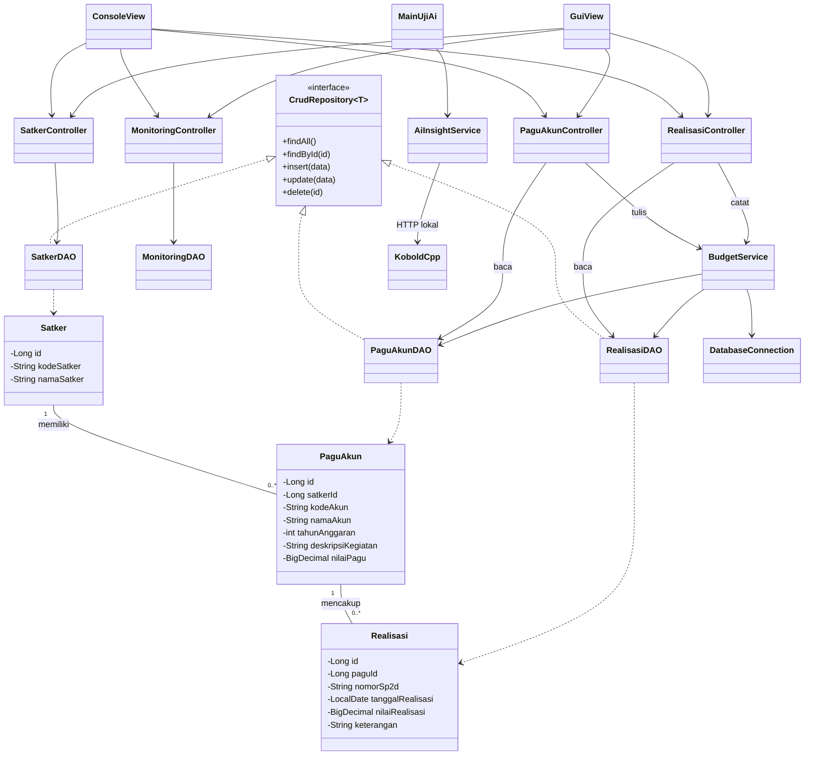
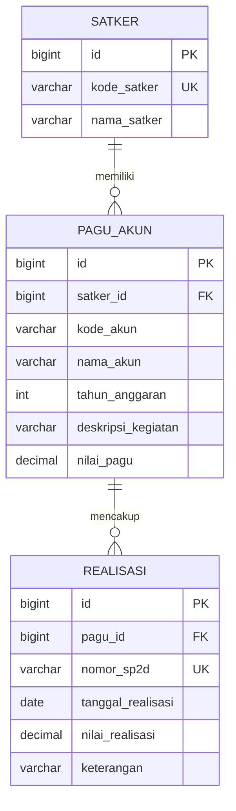

# SOFTWARE DESIGN DOCUMENT

**Monitoring Realisasi Anggaran Satker · Ringkasan untuk penguji · 17 Oktober 2026**  
**Target database: PostgreSQL 18.** Langkah Run ada di [README.md](README.md). Status target dan bukti implementasi dibedakan pada bagian 10.

## 1. Tujuan dan Ruang Lingkup

Petugas mengelola Satker, pagu per akun/kegiatan dan realisasi dengan nomor SP2D, lalu melihat sisa dan persentase anggaran. Dataset Suku Dinas Pertamanan dan Hutan Kota seluruhnya simulasi. Fitur core: CRUD Satker/pagu, pencatatan dan pembacaan realisasi, validasi sisa, rekap serta impor CSV. AI lokal dikerjakan oleh **R** sebagai tambahan; angka resmi tetap dihitung Java.

## 2. Arsitektur Aplikasi

```text
View -> Controller -> DAO -> Database
                 |
                 `-> BudgetService -> DAO -> Database

MainUjiAi -> AiInsightService -> HTTP lokal -> KoboldCpp
```

Model membawa data. Controller memvalidasi dan mengatur proses. DAO menjalankan SQL; `BudgetService` mengatur transaksi anggaran. Chat AI saat ini merupakan alur terpisah yang menerima teks, tanpa akses database atau riwayat percakapan. Pemisahan ini memudahkan pembagian tugas dan pengujian; biaya tambahannya adalah beberapa class dengan tanggung jawab kecil.

## 3. Struktur Direktori

```text
repository/                       <- buka root ini di NetBeans
|-- pom.xml
|-- README.md                     <- setup, Run dan checklist penguji
|-- SDD.md                        <- desain dan bukti
|-- Capstone_Action_Learning_Java.pdf  <- tugas asli, tetap utuh
|-- setup_demo.sql                <- dataset PostgreSQL
|-- db.properties                 <- konfigurasi database lokal
|-- config/ai.properties          <- konfigurasi AI lokal
|-- imports/                      <- contoh impor CSV
|-- docs/                         <- buglog dan hasil uji pendukung
`-- src/
    |-- main/java/
    |   |-- MainConsole.java      <- demo akses data/rekap
    |   |-- MainUjiAi.java        <- chat console lokal
    |   |-- MainUjiW.java         <- alat uji manual lama, database tersendiri
    |   |-- model/{Satker,PaguAkun,Realisasi,MonitoringRow}.java
    |   |-- dao/{CrudRepository,SatkerDAO,PaguAkunDAO,RealisasiDAO,MonitoringDAO}.java
    |   |-- controller/{SatkerController,PaguAkunController,RealisasiController,MonitoringController}.java
    |   |-- service/{BudgetService,AiInsightService}.java
    |   |-- util/{DatabaseConnection,SetupDatabase,CsvImporter,Validasi,PesanDatabase}.java
    |   `-- exception/PaguExceededException.java
    |-- resources/                <- resource yang dikonfigurasi pada pom.xml
    `-- test/java/pengujian/{ModulWTest,HasilUji}.java
```

Nama dalam `{...}` merupakan singkatan beberapa file. `db.properties` dan `config/ai.properties` dibuat pada perangkat masing-masing. Proyek nested `MonitoringRealisasi/` memiliki pom/entry point berbeda dan bukan root yang digunakan panduan ini. `MainGui` masih kerangka; diagram View di bawah menggambarkan desain antarmuka, bukan bukti GUI selesai.

## 4. Desain Kelas

### 4.1 Kelas Model

Seluruh atribut domain `private`; getter/setter mengatur akses. Uang menggunakan `BigDecimal`, tanggal `LocalDate`, ID `Long`.

| Kelas | Atribut utama | Tanggung jawab |
| --- | --- | --- |
| Satker | `id`, `kodeSatker`, `namaSatker` | Satu unit kerja. |
| PaguAkun | `id`, `satkerId`, `kodeAkun`, `namaAkun`, `tahunAnggaran`, `deskripsiKegiatan`, `nilaiPagu` | Pagu satu akun/kegiatan. |
| Realisasi | `id`, `paguId`, `nomorSp2d`, `tanggalRealisasi`, `nilaiRealisasi`, `keterangan` | Satu transaksi realisasi. |
| MonitoringRow | `kode`, `nama`, `tahun`, `totalPagu`, `totalRealisasi`, `sisaPagu`, `persentase` | Hasil rekap, bukan tabel baru. |

Contoh pola enkapsulasi seperti desain awal; kode lengkap berada di `model/Satker.java`:

```java
public class Satker {
    private Long id;
    private String kodeSatker;
    private String namaSatker;

    public Satker() { }

    public Satker(Long id, String kodeSatker, String namaSatker) {
        this.id = id;
        this.kodeSatker = kodeSatker;
        this.namaSatker = namaSatker;
    }

    public Long getId() { return id; }
    public String getKodeSatker() { return kodeSatker; }
    public void setKodeSatker(String kodeSatker) { this.kodeSatker = kodeSatker; }
    public String getNamaSatker() { return namaSatker; }
    public void setNamaSatker(String namaSatker) { this.namaSatker = namaSatker; }
}
```

### 4.2 Interface dan Polimorfisme

```java
public interface CrudRepository<T> {
    List<T> findAll();
    T findById(long id);
    void insert(T data);
    void update(T data);
    void delete(long id);
}
```

`SatkerDAO`, `PaguAkunDAO` dan `RealisasiDAO` mengimplementasikan interface. Realisasi menolak `update/delete` dengan `UnsupportedOperationException`.

```java
CrudRepository<Satker> repository = new SatkerDAO(connection);
List<Satker> daftar = repository.findAll();
```

Variabel bertipe interface menjalankan implementasi `SatkerDAO`; ini penggunaan polimorfisme dalam kode.

### 4.3 Kelas DAO

| Kelas | Tanggung jawab |
| --- | --- |
| SatkerDAO | CRUD Satker. |
| PaguAkunDAO | Akses pagu; menyediakan operasi lock/perubahan untuk service. |
| RealisasiDAO | Tambah/baca transaksi dan hitung total realisasi. |
| MonitoringDAO | Rekap per Satker/akun, total serta periode. |

Query data memakai `PreparedStatement`. DAO dalam transaksi memakai koneksi yang diberikan service. `List` menyimpan kumpulan hasil; `Map<Integer, BigDecimal>` menyimpan rekap per bulan/tahun.

### 4.4 Kelas Controller

| Kelas | Tanggung jawab |
| --- | --- |
| SatkerController | Validasi dan CRUD Satker. |
| PaguAkunController | Pengelolaan pagu melalui service untuk penulisan. |
| RealisasiController | Pencatatan melalui BudgetService dan pembacaan transaksi. |
| MonitoringController | Mengambil rekap dari MonitoringDAO. |

Controller tidak otomatis memberikan data ke AI. Versi chat yang diperiksa dipanggil langsung oleh `MainUjiAi`.

### 4.5 Kelas Utilitas, Service dan Exception

- `DatabaseConnection`: membaca konfigurasi dan membuka koneksi JDBC.
- `BudgetService`: mengunci pagu, memeriksa sisa dan menjalankan commit/rollback.
- `CsvImporter`: preview, validasi dan penyimpanan satu file secara atomik.
- `Validasi` / `PesanDatabase`: aturan input dan penerjemahan kegagalan database.
- `PaguExceededException`: pelanggaran sisa pagu.
- `AiInsightService`: Properties + Gson + HttpClient; kirim teks ke KoboldCpp, baca `choices[0].message.content`, kembalikan pesan fallback jika gagal. Connect timeout 2 detik; request timeout saat diperiksa 120 detik, batas keluaran 1.024 token. Tidak memerlukan proyek plugin.

## 5. Hubungan Antarkelas

Satu Satker memiliki banyak pagu; satu pagu memiliki banyak realisasi. Setiap pagu menunjuk satu Satker melalui `satkerId`; setiap realisasi menunjuk satu pagu melalui `paguId`.



`0..*` berarti nol atau banyak; garis segitiga putus berarti implementasi interface. View menunjukkan rancangan antarmuka bersama; status kelengkapannya mengikuti bagian 10.

## 6. Desain Database PostgreSQL 18



PK = identitas baris; FK = hubungan induk; UK = nilai unik. Kombinasi `satker_id + kode_akun + tahun_anggaran + deskripsi_kegiatan` juga unik. Nominal memakai `DECIMAL(18,2)`. Seluruh kolom wajib kecuali `keterangan`. Foreign key menolak penghapusan induk yang masih dipakai.

`setup_demo.sql` berisi skema dan data Suku Dinas: 12 Satker, 26 pagu, 52 realisasi. ID awal eksplisit; identity berikutnya 13, 27, 53. Jalankan manual pada database latihan karena script mereset tiga tabel. Contoh PostgreSQL:

```sql
CREATE TABLE satker (
    id BIGINT GENERATED BY DEFAULT AS IDENTITY PRIMARY KEY,
    kode_satker VARCHAR(20) NOT NULL UNIQUE,
    nama_satker VARCHAR(120) NOT NULL
);
```

## 7. Aturan Bisnis

| Data/proses | Aturan penting |
| --- | --- |
| Satker | Kode/nama wajib, kode unik; hapus hanya jika tidak mempunyai pagu. |
| Pagu | Satker valid, identitas lengkap, nilai >= 0; kombinasi identitas unik. |
| Perubahan pagu | Nilai baru >= total realisasi; identitas pagu terpakai tidak boleh diganti. |
| Realisasi | Pagu valid, SP2D wajib/unik, tanggal valid, nilai > 0 dan <= sisa. Transaksi tersimpan hanya dibaca. |
| Uang | BigDecimal; maksimal 2 desimal dan 16 digit sebelum desimal. |
| Rekap | Sisa = pagu - realisasi; persen = realisasi / pagu x 100; pagu nol menghasilkan 0%. Jumlahkan uang sebelum menghitung persen gabungan. |
| Periode | Bulan/tahun transaksi mengikuti tanggal realisasi; tahun anggaran mengikuti pagu. |
| CSV | Impor Satker dahulu, lalu pagu; preview/konfirmasi, tolak duplikat; satu file satu transaksi. Satu baris gagal membatalkan seluruh file. |

**Transaksi aman:** buka satu koneksi → isolation `READ_COMMITTED`, auto-commit mati → lock pagu `SELECT ... FOR UPDATE` → hitung total → validasi → tulis → commit. Kegagalan menyebabkan rollback. Penurunan pagu memakai lock yang sama; DAO tidak menutup koneksi transaksi milik service.

## 8. Exception yang Krusial

| Kondisi | Penanganan |
| --- | --- |
| Input kosong/format/nominal salah | Tolak dengan pesan field yang jelas; kembali ke pemanggil/menu. |
| Pagu terlampaui | `PaguExceededException`, rollback, tampilkan sisa. |
| Duplikat/FK/kegagalan SQL | Terjemahkan SQLException, rollback jika bertransaksi; detail teknis tanpa password. |
| AI mati/timeout/JSON tidak valid | Pesan AI tidak tersedia; core tetap terpisah. Interupsi thread dipulihkan. |

Statement/ResultSet ditutup melalui try-with-resources. Input data diikat ke PreparedStatement; nama kolom/arah urut dipilih dari daftar tetap.

## 9. Checklist Pengujian

Centang hanya setelah dicoba pada versi yang diserahkan. Dataset harus bersih untuk membandingkan angka awal; jangan memakai database tes bersama untuk kasus yang mengubah data.

| Cek | Skenario | Hasil yang diharapkan |
| --- | --- | --- |
| [ ] | Build dan Test | BUILD SUCCESS; catat jumlah tes dan database yang dipakai. |
| [ ] | PostgreSQL 18 | Koneksi Java berhasil; 12/26/52 record dan data bertahan setelah restart. |
| [ ] | CRUD Satker dan pagu | Tambah/baca/ubah/hapus valid; kosong, duplikat dan FK ditolak. |
| [ ] | Batas pagu | Dari data awal, pagu 1 mempunyai sisa Rp7,2 juta: tepat sisa diterima, Rp1 berikutnya ditolak. |
| [ ] | Transaksi bersamaan | Dua pencatatan Rp5 juta pada sisa Rp7,2 juta: hanya satu commit. |
| [ ] | Identitas/nilai pagu | Identitas terpakai dan penurunan nilai di bawah realisasi ditolak. |
| [ ] | Rekap awal 2026 | Pagu Rp4.050.000.000; realisasi Rp1.798.750.000; sisa Rp2.251.250.000; 44,41%. |
| [ ] | Impor jika disertakan | Preview/batal, file valid, file salah, rollback dan impor ulang diperiksa. |
| [ ] | AI | Aktif, dinonaktifkan, server mati, timeout; jawaban sesuai teks yang diberikan. |

## 10. Status Implementasi dan Bukti Uji

| Bagian | Bukti dan batas kesimpulan |
| --- | --- |
| Core | 33 tes ModulWTest lulus pada build lokal terakhir yang dicatat; [log W](docs/hasil-uji-W.txt) adalah bukti snapshot sebelumnya. Tes tersebut menggunakan H2, bukan bukti kompatibilitas PostgreSQL 18. |
| PostgreSQL 18 | SQL tersedia pada `setup_demo.sql`. Root pom belum memuat driver PostgreSQL; DatabaseConnection masih default H2; MainConsole masih memeriksa metadata huruf besar dan dapat menjalankan setup H2. MainUjiW juga memakai H2 tersendiri. Penyelarasan dan uji runtime PostgreSQL belum terverifikasi. |
| Antarmuka | MainConsole merupakan demo DAO/rekap; MainUjiW alat uji modul. MainGui masih TODO. Proyek nested memiliki konfigurasi Java 26; tidak digunakan untuk langkah README. |
| AI lokal | Log demo pengguna menunjukkan Gemma menjawab melalui API localhost. MainUjiAi adalah chat tanpa riwayat; belum ada pengambilan data DB otomatis. Pengamatan ini bukan klaim seluruh uji AI otomatis sudah ada di repo. |
| Bug | [Buglog W](docs/buglog-W.md) memuat lima temuan, penyebab, perbaikan dan method uji ulang: bypass pagu, pagu di bawah realisasi, identitas pagu terpakai, teks spasi dan pembulatan nominal. |

## 11. Kontribusi dan Penyerahan

Pembagian desain tim: **At** model/SQL; **Al** JDBC/DAO; **W** service, validasi dan CSV; **C** antarmuka/integrasi; **R** mutu dan AI lokal. Cocokkan kontribusi akhir dengan commit serta laporan; pembagian ini bukan bukti penyelesaian tiap anggota.

Ketua menyerahkan tautan repository, SQL/data dummy, laporan PDF maksimal 10 halaman dan video maksimal 5 menit. Laporan menyertakan identitas/peran, masalah, desain/alternatif, hasil fitur dan pengujian, minimal tiga bug nyata, kendala, serta alat AI dan bagian yang dibantu. Deadline yang disetujui: Jumat, 16 Oktober 2026 pukul 23.00 WIB.

Dokumen tugas asli [Capstone_Action_Learning_Java.pdf](Capstone_Action_Learning_Java.pdf) tetap menjadi rujukan dan tidak diubah. Konfigurasi aktual/password dan model GGUF tidak dimasukkan sebagai source code.
