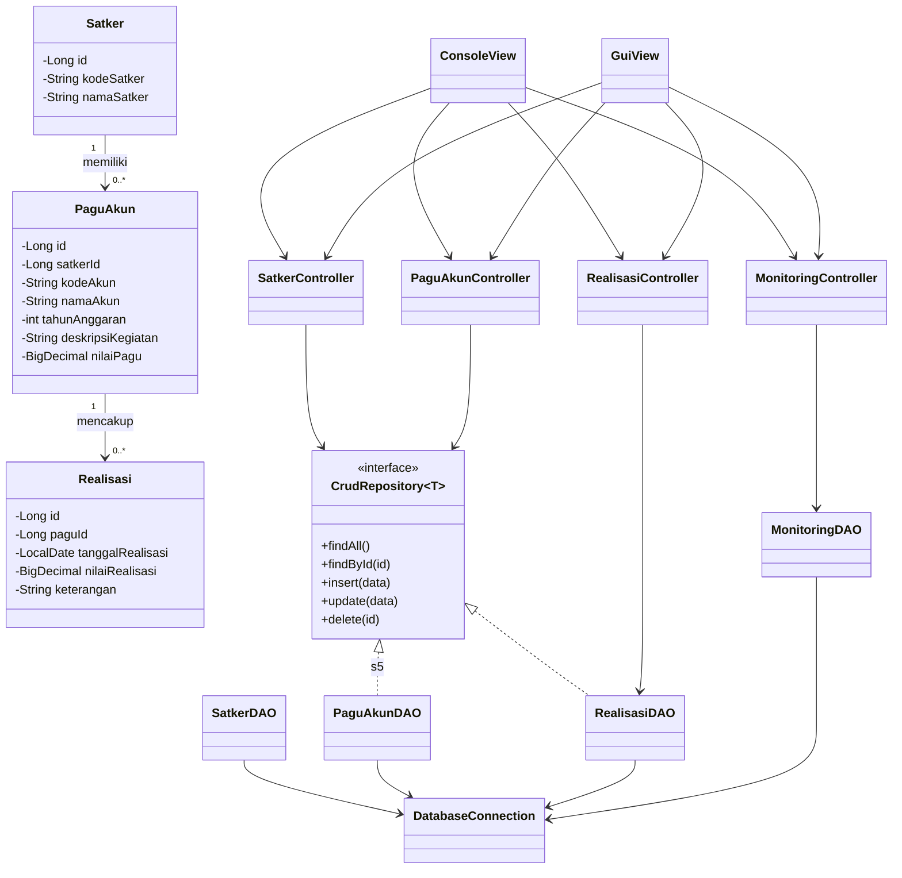

# SOFTWARE DESIGN DOCUMENT (SDD)

## Aplikasi Monitoring Realisasi Anggaran Satker

**Versi:** 2.0  
**Teknologi:** Java 25, Maven, JDBC, H2 Database  
**Arsitektur:** Model-View-Controller (MVC) dengan Data Access Object (DAO)

## 1. Tujuan dan Ruang Lingkup

Aplikasi digunakan untuk mengelola data satuan kerja (Satker), pagu akun, dan transaksi realisasi anggaran, serta memantau sisa anggaran dan persentase realisasi.

Fitur utama:

1. Pengelolaan data Satker: tambah, lihat, ubah, dan hapus.
2. Pengelolaan pagu akun dan kegiatan anggaran.
3. Pencatatan dan penampilan transaksi realisasi.
4. Monitoring pagu, total realisasi, sisa anggaran, dan persentase realisasi.
5. Rekapitulasi realisasi bulanan dan tahunan.
6. Antarmuka Console dan GUI menggunakan aturan bisnis yang sama.

Aplikasi tidak menggunakan autentikasi pengguna.

## 2. Arsitektur Aplikasi

Aplikasi menggunakan pola MVC dengan pemisahan akses database melalui DAO.

- **Model:** Menyimpan representasi data dan aturan dasar domain.
- **DAO:** Menjalankan query JDBC untuk membaca dan mengubah data database.
- **Controller:** Mengatur alur proses, validasi input, dan penanganan kesalahan.
- **View:** Menyediakan antarmuka Console atau GUI.
- **Util:** Menyediakan koneksi dan konfigurasi database.

Alur proses:

`View → Controller → Model/DAO → Database`

Hasil pengolahan dikembalikan melalui Controller untuk ditampilkan oleh View.

## 3. Struktur Direktori

```text
src/
├── main/java/
│   ├── model/
│   │   ├── Satker.java
│   │   ├── PaguAkun.java
│   │   └── Realisasi.java
│   ├── dao/
│   │   ├── CrudRepository.java
│   │   ├── SatkerDAO.java
│   │   ├── PaguAkunDAO.java
│   │   ├── RealisasiDAO.java
│   │   └── MonitoringDAO.java
│   ├── controller/
│   │   ├── SatkerController.java
│   │   ├── PaguAkunController.java
│   │   ├── RealisasiController.java
│   │   └── MonitoringController.java
│   ├── view/
│   │   ├── console/
│   │   └── gui/
│   ├── util/
│   │   └── DatabaseConnection.java
│   ├── exception/
│   │   └── PaguExceededException.java
│   ├── MainConsole.java
│   └── MainGui.java
├── test/java/
└── resources/
    └── db.properties.example
```

File `db.properties` yang berisi konfigurasi lokal tidak ikut dikumpulkan. File contoh `db.properties.example` disediakan sebagai template.

## 4. Desain Kelas

### 4.1 Kelas Model

Seluruh atribut domain bersifat `private`. Akses atribut dilakukan melalui getter dan setter yang sesuai.

| Kelas | Atribut utama | Tanggung jawab |
|---|---|---|
| `Satker` | `id`, `kodeSatker`, `namaSatker` | Merepresentasikan data Satker. |
| `PaguAkun` | `id`, `satkerId`, `kodeAkun`, `namaAkun`, `tahunAnggaran`, `deskripsiKegiatan`, `nilaiPagu` | Merepresentasikan pagu untuk suatu akun dan kegiatan. |
| `Realisasi` | `id`, `paguId`, `tanggalRealisasi`, `nilaiRealisasi`, `keterangan` | Merepresentasikan transaksi realisasi. |

Nilai uang menggunakan `BigDecimal` untuk menjaga ketelitian perhitungan.

Contoh deklarasi kelas:

```java
public class Satker {
    private Long id;
    private String kodeSatker;
    private String namaSatker;

    public Long getId() {
        return id;
    }

    public String getKodeSatker() {
        return kodeSatker;
    }

    public void setKodeSatker(String kodeSatker) {
        this.kodeSatker = kodeSatker;
    }

    public String getNamaSatker() {
        return namaSatker;
    }

    public void setNamaSatker(String namaSatker) {
        this.namaSatker = namaSatker;
    }
}
```

Pola enkapsulasi yang sama diterapkan pada `PaguAkun` dan `Realisasi`. Setter hanya disediakan untuk atribut yang memang boleh diubah.

### 4.2 Interface dan Polimorfisme

Interface `CrudRepository<T>` menyediakan operasi akses data yang umum digunakan.

```java
public interface CrudRepository<T> {
    List<T> findAll();
    T findById(long id);
    void insert(T data);
    void update(T data);
    void delete(long id);
}
```

Implementasi:

- `SatkerDAO implements CrudRepository<Satker>`
- `PaguAkunDAO implements CrudRepository<PaguAkun>`
- `RealisasiDAO implements CrudRepository<Realisasi>`

Operasi `update()` dan `delete()` pada `RealisasiDAO` tidak boleh digunakan untuk mengubah atau menghapus transaksi realisasi. Implementasi dapat menolak operasi tersebut dengan exception. Controller realisasi hanya menyediakan pencatatan dan pembacaan transaksi.

Contoh penggunaan polimorfisme:

```java
CrudRepository<Satker> repository =
        new SatkerDAO(connection);

List<Satker> daftarSatker = repository.findAll();
```

Variabel `repository` menggunakan tipe interface, tetapi pemanggilan metode dijalankan oleh implementasi `SatkerDAO`. Dengan demikian, interface digunakan dalam kode, bukan sekadar dideklarasikan.

### 4.3 Kelas DAO

| Kelas | Tanggung jawab |
|---|---|
| `SatkerDAO` | CRUD Satker melalui JDBC. |
| `PaguAkunDAO` | Menambah, melihat, dan mengubah pagu; penghapusan mengikuti aturan integritas referensial. |
| `RealisasiDAO` | Menambah dan melihat transaksi realisasi serta menghitung total realisasi. |
| `MonitoringDAO` | Mengambil data monitoring dan rekapitulasi berdasarkan periode. |

Seluruh query dijalankan menggunakan `PreparedStatement`. Nilai input tidak boleh digabungkan langsung ke string SQL.

### 4.4 Kelas Controller

| Kelas | Tanggung jawab |
|---|---|
| `SatkerController` | Memvalidasi dan mengatur CRUD Satker. |
| `PaguAkunController` | Memvalidasi dan mengatur pengelolaan pagu. |
| `RealisasiController` | Memvalidasi dan mencatat realisasi, termasuk menangani pelanggaran pagu. |
| `MonitoringController` | Mengambil data monitoring serta menyiapkan rekapitulasi. |

Controller menangani input dari View dan mengembalikan hasil atau pesan kesalahan yang dapat dipahami pengguna.

### 4.5 Kelas Utilitas dan Exception

- `DatabaseConnection`: membaca konfigurasi dan menyediakan koneksi JDBC.
- `PaguExceededException`: exception khusus ketika pencatatan realisasi melampaui pagu.
- `MainConsole`: menjalankan aplikasi Console.
- `MainGui`: menjalankan aplikasi GUI Swing.

## 5. Hubungan Antarkelas

Diagram berikut menggunakan sintaks Mermaid `classDiagram`.



Hubungan domain:

- Satu Satker dapat memiliki banyak pagu akun.
- Satu pagu akun dapat memiliki banyak transaksi realisasi.
- Setiap pagu akun terhubung ke satu Satker.
- Setiap transaksi realisasi terhubung ke satu pagu akun.

## 6. Desain Database

Database menggunakan H2 berbasis file dengan tiga tabel utama.

### 6.1 Tabel `satker`

| Kolom | Tipe | Keterangan |
|---|---|---|
| `id` | BIGINT | Primary key |
| `kode_satker` | VARCHAR | Kode Satker, unik |
| `nama_satker` | VARCHAR | Nama Satker |

### 6.2 Tabel `pagu_akun`

| Kolom | Tipe | Keterangan |
|---|---|---|
| `id` | BIGINT | Primary key |
| `satker_id` | BIGINT | Foreign key ke `satker.id` |
| `kode_akun` | VARCHAR | Kode akun |
| `nama_akun` | VARCHAR | Nama akun |
| `tahun_anggaran` | INT | Tahun anggaran |
| `deskripsi_kegiatan` | VARCHAR | Pembeda kegiatan |
| `nilai_pagu` | DECIMAL | Nilai pagu |

Kombinasi `satker_id`, `kode_akun`, `tahun_anggaran`, dan `deskripsi_kegiatan` harus unik.

### 6.3 Tabel `realisasi`

| Kolom | Tipe | Keterangan |
|---|---|---|
| `id` | BIGINT | Primary key |
| `pagu_id` | BIGINT | Foreign key ke `pagu_akun.id` |
| `tanggal_realisasi` | DATE | Tanggal transaksi |
| `nilai_realisasi` | DECIMAL | Nilai transaksi |
| `keterangan` | VARCHAR | Keterangan transaksi |

Relasi antartabel menggunakan foreign key. Penghapusan Satker atau pagu yang masih memiliki data terkait harus ditolak agar integritas referensial tetap terjaga.

## 7. Konfigurasi Database dan Keamanan Query

### 7.1 Konfigurasi

Contoh file `db.properties.example`:

```properties
db.url=jdbc:h2:./data/monitoring_anggaran
db.user=sa
db.password=
```

Aplikasi membaca nilai tersebut melalui `java.util.Properties`. File lokal `db.properties` dibuat berdasarkan contoh dan dimasukkan ke `.gitignore`.

Kredensial tidak ditulis langsung di source code. Konfigurasi aktual tidak ikut dikumpulkan; hanya file contoh yang disertakan.

### 7.2 PreparedStatement

Seluruh query menggunakan `PreparedStatement`, termasuk query tambah, ubah, hapus, pencarian, monitoring, dan rekapitulasi.

Contoh:

```java
String sql = "SELECT * FROM satker WHERE kode_satker = ?";
PreparedStatement ps = connection.prepareStatement(sql);
ps.setString(1, kodeSatker);

ResultSet rs = ps.executeQuery();
```

Penggabungan string dari input pengguna ke perintah SQL tidak diperbolehkan. Nama kolom dan arah pengurutan yang tidak dapat diikat sebagai parameter harus dipilih dari daftar nilai yang telah ditentukan aplikasi.

## 8. Aturan Bisnis dan Proses

### 8.1 Pengelolaan Satker

1. Pengguna mengisi data Satker.
2. Controller memeriksa input wajib dan format data.
3. DAO menyimpan atau memperbarui data menggunakan `PreparedStatement`.
4. Kode Satker harus unik.
5. Penghapusan ditolak jika Satker masih memiliki pagu akun.

CRUD Satker mencakup tambah, lihat, ubah, dan hapus.

### 8.2 Pengelolaan Pagu

1. Pengguna memilih Satker dan mengisi data pagu.
2. Controller memvalidasi nilai pagu dan kelengkapan data.
3. DAO menyimpan data dengan foreign key yang valid.
4. Kombinasi Satker, akun, tahun anggaran, dan deskripsi kegiatan harus unik.
5. Penghapusan pagu ditolak jika masih memiliki transaksi realisasi.

### 8.3 Pencatatan Realisasi

1. Pengguna memilih pagu akun.
2. Pengguna mengisi tanggal, nilai realisasi, dan keterangan.
3. Controller memvalidasi input.
4. DAO memulai transaksi database dan memeriksa total realisasi yang sudah tercatat.
5. Jika total baru melebihi pagu, proses dibatalkan dan `PaguExceededException` ditangani oleh Controller.
6. Jika valid, data disimpan dan transaksi di-commit.
7. Transaksi realisasi yang sudah tersimpan tidak dapat diubah atau dihapus melalui aplikasi.

Pemeriksaan batas pagu dan penyimpanan harus berlangsung dalam transaksi database yang aman terhadap pencatatan bersamaan, misalnya dengan mengunci baris pagu selama validasi dan penyimpanan.

### 8.4 Monitoring

Untuk setiap pagu akun, aplikasi menampilkan:

- Total realisasi.
- Sisa anggaran = nilai pagu − total realisasi.
- Persentase realisasi = total realisasi ÷ nilai pagu × 100%.

Jika nilai pagu nol, persentase ditetapkan sebesar 0% agar tidak terjadi pembagian dengan nol.

## 9. Collections dan Rekapitulasi

Data hasil query disimpan dan diolah menggunakan Java Collections.

Contoh:

```java
List<Realisasi> daftarRealisasi;
Map<Integer, BigDecimal> totalRealisasiPerBulan;
Map<Integer, BigDecimal> totalRealisasiPerTahun;
```

- `List<Realisasi>` menyimpan kumpulan transaksi untuk ditampilkan atau diproses.
- `Map<Integer, BigDecimal>` menyimpan total berdasarkan bulan atau tahun.
- Rekapitulasi difilter berdasarkan Satker, akun, kegiatan, dan periode yang dipilih.

Rekap bulanan menggunakan bulan dari tanggal realisasi. Rekap tahunan menggunakan tahun dari tanggal realisasi, sedangkan filter tahun anggaran mengikuti data pagu yang dipilih.

## 10. Validasi dan Exception Handling

Aplikasi menangani kesalahan tanpa menghentikan program secara mendadak.

| Kondisi | Penanganan |
|---|---|
| Input wajib kosong | Tampilkan pesan bahwa kolom wajib harus diisi. |
| Input angka tidak valid | Tampilkan pesan format angka tidak valid. |
| Tanggal tidak valid | Tampilkan pesan format tanggal tidak valid. |
| Kode Satker duplikat | Tolak penyimpanan dan tampilkan pesan yang jelas. |
| Nilai pagu negatif | Tolak penyimpanan. |
| Nilai realisasi nol atau negatif | Tolak pencatatan. |
| Realisasi melebihi pagu | Tangani `PaguExceededException` dan tampilkan pesan pelanggaran batas pagu. |
| Data terkait masih digunakan | Tolak penghapusan dan jelaskan hubungan data yang menghalangi. |
| Kegagalan database | Catat detail teknis yang diperlukan, tampilkan pesan yang aman, dan rollback transaksi yang gagal. |

Contoh custom exception:

```java
public class PaguExceededException extends RuntimeException {
    public PaguExceededException(String message) {
        super(message);
    }
}
```

Controller menangkap exception yang relevan. View Console menampilkan pesan melalui keluaran teks, sedangkan View GUI menggunakan dialog Swing.

## 11. Antarmuka Pengguna

Aplikasi menyediakan dua alternatif antarmuka dengan Controller dan Model yang sama.

**Console**

- Menu pengelolaan Satker.
- Menu pengelolaan pagu.
- Menu pencatatan dan penampilan realisasi.
- Menu monitoring dan rekapitulasi.

**GUI Swing**

- Form Satker.
- Form pagu akun.
- Form realisasi.
- Tabel monitoring dan rekapitulasi.
- Dialog validasi dan kesalahan.

Keduanya menjalankan aturan validasi dan bisnis yang sama.

